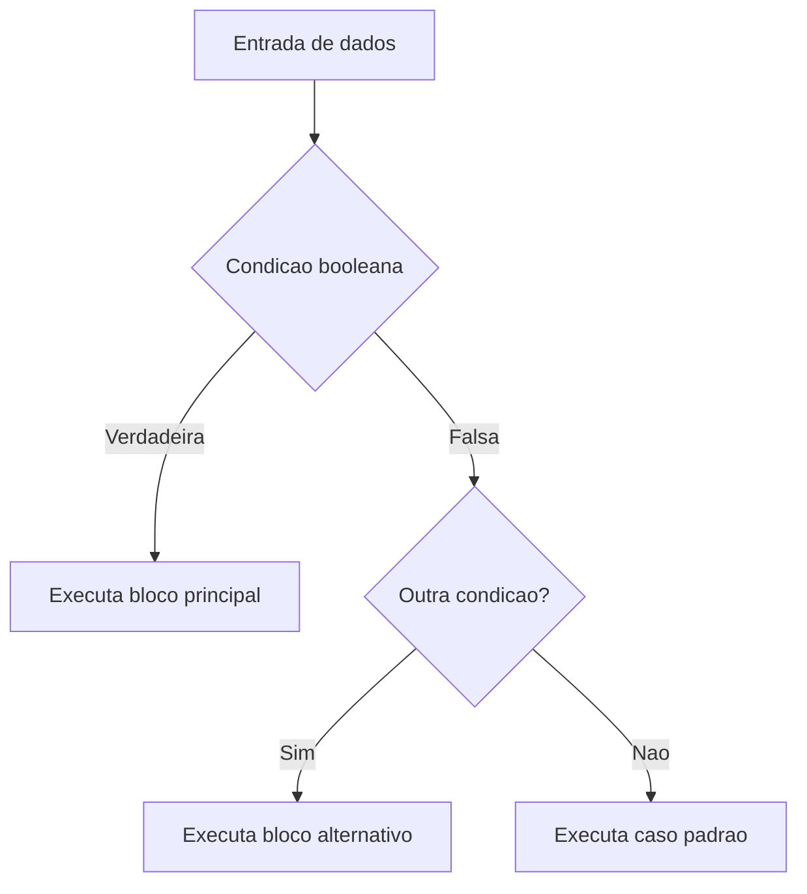

# Estruturas de controle, modularização, estruturas de dados homogêneas e recursividade

## 1. Introdução

Estruturas de controle, mecanismos de modularização, arranjos homogêneos e recursividade formam a base da construção de algoritmos em linguagens imperativas como C. Esses elementos definem, respectivamente, como o fluxo de execução é dirigido, como responsabilidades são particionadas, como coleções homogêneas são representadas em memória e como problemas podem ser resolvidos por decomposição auto-referente. Em conjunto, eles estabelecem a infraestrutura conceitual sobre a qual algoritmos mais sofisticados, estruturas de dados avançadas e sistemas de software robustos são desenvolvidos (Knuth, 1997; Cormen et al., 2009).

Do ponto de vista pedagógico e científico, a compreensão aprofundada desses temas exige articular semântica operacional, custo computacional, implicações de implementação e padrões de uso. Em C, essa discussão torna-se particularmente relevante porque a linguagem expõe detalhes de armazenamento, escopo, passagem de parâmetros e aritmética de ponteiros, permitindo observar com clareza a relação entre abstração algorítmica e comportamento concreto em memória (Ziviani, 2004).

## 2. Fundamentação Teórica

### 2.1 Fluxo de controle e semântica imperativa

Em programação imperativa, o estado do programa é modificado por uma sequência de comandos. Estruturas de controle disciplinam essa sequência, permitindo seleção condicional e repetição. A instrução `if` implementa desvio condicional binário; `if-else if-else` permite encadeamentos hierárquicos de predicado; `switch` oferece despacho multi-ramo com custo lógico geralmente mais legível quando as alternativas são valores discretos de uma expressão inteira ou enumerada (Cormen et al., 2012).

Do ponto de vista formal, essas construções podem ser descritas por funções de transição de estado. A relevância acadêmica reside em que decisões mal modeladas aumentam complexidade ciclomática, reduzem verificabilidade e ampliam risco de erros semânticos, como o clássico problema do dangling else.

### 2.2 Repetição e invariantes de laço

Laços `while`, `do-while` e `for` expressam iteração controlada por predicado, pós-teste ou contador. A análise correta dessas estruturas exige o conceito de invariante de laço: uma propriedade que permanece verdadeira antes e após cada iteração. Invariantes permitem provar correção parcial e total, além de sustentar análises assintóticas rigorosas (Knuth, 1997).

### 2.3 Modularização e abstração procedimental

Funções e procedimentos reduzem acoplamento, aumentam coesão e tornam a prova de correção local. Em C, funções retornam um valor ou `void`, e a interface é declarada por protótipos. A linguagem realiza passagem por valor; a chamada por referência é simulada por meio do repasse de endereços, o que torna explícitas as implicações de aliasing, mutabilidade e custo de cópia (Horowitz; Sahni, 1986).

### 2.4 Estruturas homogêneas e layout de memória

Vetores e matrizes são estruturas homogêneas porque armazenam elementos de mesmo tipo em posições contíguas. Esse arranjo fornece acesso aleatório em tempo constante, mas impõe tamanho fixo em sua forma estática e custo elevado para inserções e remoções internas. Matrizes em C são armazenadas em ordem row-major - ou seja, linha por linha - de modo que a travessia por linhas explora localidade espacial de cache com maior eficiência (Sedgewick, 1998).

### 2.5 Recursividade

Recursividade descreve algoritmos em que a solução de um problema depende de soluções para instâncias menores do mesmo problema. Seus componentes compõem caso base, redução do problema e progresso em direção à parada. Embora elegantemente alinhada à definição de estruturas indutivas, a recursão traz custos de empilhamento, possíveis riscos de estouro de pilha e, em alguns casos, redundância computacional, como em implementações ingênuas de Fibonacci (Cormen et al., 2009).

## 3. Desenvolvimento

### 3.1 Estruturas de decisão

As estruturas de decisão permitem que um algoritmo escolha diferentes caminhos de execução com base na avaliação de condições lógicas. Elas constituem um dos mecanismos fundamentais para o controle de fluxo em programas, possibilitando adaptar o comportamento do sistema de acordo com os dados de entrada ou com o estado da execução.

A estrutura `if` simples é utilizada quando apenas uma ação deve ser executada caso determinada condição seja verdadeira. Trata-se da forma mais elementar de decisão e normalmente apresenta alta legibilidade para verificações pontuais.

Quando existem múltiplos caminhos possíveis, pode-se utilizar cadeias de `if-else if`, nas quais as condições são avaliadas sequencialmente até que uma delas seja satisfeita. Essa abordagem oferece grande flexibilidade, pois cada condição pode envolver expressões distintas. Entretanto, o aumento do número de testes tende a elevar a complexidade do código e dificultar sua manutenção.

A estrutura `switch` é indicada para situações em que uma única variável deve ser comparada com diversos valores discretos. Em muitos casos, ela proporciona maior legibilidade do que longas cadeias de `if-else if`. Dependendo da linguagem e do compilador utilizados, a implementação pode ser otimizada por meio de tabelas de salto (*jump tables*), reduzindo o custo das comparações.

A Figura 1 apresenta um fluxo genérico de tomada de decisão em algoritmos.



A Tabela 1 resume as principais características das estruturas de decisão discutidas.

| Estrutura    | Facilidade de implementação | Facilidade de uso | Desempenho | Consumo de memória | Vantagens                         | Desvantagens                             | Casos de uso                         | Big O lógico |
| ------------ | --------------------------- | ----------------- | ---------- | ------------------ | --------------------------------- | ---------------------------------------- | ------------------------------------ | ------------ |
| `if` simples | Alta                        | Alta              | Excelente  | O(1)               | Clareza para decisão binária      | Escala mal com muitos casos              | Validação simples                    | O(1)         |
| `if-else if` | Alta                        | Média             | Excelente  | O(1)               | Flexível para múltiplas condições | Pode aumentar a complexidade ciclomática | Regras de negócio                    | O(k)         |
| `switch`     | Alta                        | Alta              | Muito bom  | O(1)               | Legibilidade para casos discretos | Menos flexível para expressões complexas | Menus, estados, analisadores léxicos | O(1) a O(k)  |

#### Exemplo 1: classificação de desempenho acadêmico

**Explicação teórica.** O algoritmo classifica uma nota em quatro categorias por decisão múltipla hierárquica. A ordem dos predicados é importante para preservar exclusividade e evitar avaliações redundantes.

**Pseudocódigo**

```text
algoritmo classificar_nota(nota)
    se nota < 0 ou nota > 100 então
        escreva "invalida"
    senao se nota >= 85 então
        escreva "excelente"
    senao se nota >= 70 então
        escreva "boa"
    senao se nota >= 50 então
        escreva "suficiente"
    senao
        escreva "insuficiente"
fim
```

**Implementação completa em C**

```c
#include <stdio.h>

const char *classificar_nota(int nota) {
    if (nota < 0 || nota > 100) {
        return "invalida";
    }

    if (nota >= 85) {
        return "excelente";
    }

    if (nota >= 70) {
        return "boa";
    }

    if (nota >= 50) {
        return "suficiente";
    }

    return "insuficiente";
}

int main(void) {
    int nota = 78;
    printf("Nota %d -> %s\n", nota, classificar_nota(nota));
    return 0;
}
```

**Complexidade.** Tempo $O(1)$, espaço adicional $O(1)$.

**Partes importantes.** A primeira guarda evita estados inválidos; a sequência decrescente de limites elimina sobreposição de casos; o retorno imediato simplifica controle de fluxo.

**Entrada e saída.** Entrada: `78`. Saída: `Nota 78 -> boa`.

**Análise de desempenho.** O custo é constante, mas o número médio de comparações depende da distribuição das notas. Em distribuições concentradas em notas altas, a ordenação atual é favorável.

**Comparação com alternativas.** Uma versão com `switch` não seria adequada porque as faixas de nota são intervalares, não valores discretos isolados.

### 3.2 Estruturas de repetição

Estruturas de repetição permitem executar um bloco de instruções múltiplas vezes, reduzindo a duplicação de código e possibilitando o processamento eficiente de coleções de dados, sequências numéricas e condições iterativas. Essas estruturas constituem um dos principais mecanismos de controle de fluxo em algoritmos.

A estrutura `while` é utilizada quando o número de iterações não é conhecido previamente e a continuidade da execução depende da avaliação de uma condição lógica. Antes de cada iteração, a condição é verificada; caso seja falsa desde o início, o corpo do laço não será executado.

A estrutura `do-while` possui comportamento semelhante ao `while`, porém garante que o bloco de instruções seja executado pelo menos uma vez, pois a condição é avaliada somente ao final de cada iteração. Essa característica a torna adequada para menus interativos e rotinas de validação de entrada.

A estrutura `for` é geralmente empregada quando existe uma variável de controle e o número de repetições é conhecido ou pode ser determinado previamente. Sua sintaxe concentra inicialização, condição de parada e atualização da variável de controle em um único comando, favorecendo a legibilidade em percursos sequenciais.

A escolha entre essas estruturas depende principalmente da previsibilidade do número de iterações e da forma como a condição de continuidade é expressa. Em termos de eficiência, todas apresentam custo proporcional à quantidade de iterações realizadas, diferindo principalmente em legibilidade, facilidade de manutenção e adequação ao problema modelado.

A Tabela 2 resume as principais características das estruturas de repetição.

| Estrutura  | Facilidade de implementação | Facilidade de uso | Desempenho | Consumo de memória | Vantagens                          | Desvantagens                           | Casos de uso                 | Big O das operações principais |
| ---------- | --------------------------- | ----------------- | ---------- | ------------------ | ---------------------------------- | -------------------------------------- | ---------------------------- | ------------------------------ |
| `while`    | Alta                        | Alta              | Muito bom  | O(1)               | Natural para laços condicionais    | Mais propenso a laços infinitos        | Leitura até sentinela        | O(n)                           |
| `do-while` | Média                       | Média             | Muito bom  | O(1)               | Garante ao menos uma execução      | Menos utilizado em linguagens modernas | Menus e validação de entrada | O(n)                           |
| `for`      | Alta                        | Alta              | Excelente  | O(1)               | Compacto para contagem e percursos | Pode concentrar lógica excessiva       | Vetores, matrizes e coleções | O(n)                           |

#### Exemplo 2: média e desvio de notas usando vetores

**Explicação teórica.** O algoritmo percorre um vetor em duas etapas. Na primeira passagem, calcula-se a soma dos elementos para obtenção da média aritmética. Na segunda passagem, calcula-se a soma dos desvios quadráticos em relação à média, permitindo determinar a variância e o desvio padrão.

A utilização de dois percursos independentes torna o algoritmo mais simples de compreender e implementar, além de evitar problemas numéricos que podem surgir em fórmulas alternativas que tentam calcular todas as estatísticas em uma única passagem. Como cada percurso visita todos os elementos uma vez, o custo total permanece linear em relação ao tamanho do vetor, resultando em complexidade temporal O(n).  

**Pseudocódigo**

```text
algoritmo estatisticas(vetor, n)
    soma <- 0
    para i de 0 ate n - 1 faca
        soma <- soma + vetor[i]
    media <- soma / n

    soma_quadrados <- 0
    para i de 0 ate n - 1 faca
        diferenca <- vetor[i] - media
        soma_quadrados <- soma_quadrados + diferenca * diferenca
    retorne media e variancia
fim
```

**Implementação completa em C**

```c
#include <math.h>
#include <stdio.h>

typedef struct {
    double media;
    double variancia;
} Estatisticas;

Estatisticas calcular_estatisticas(const int valores[], int tamanho) {
    long soma = 0;
    double soma_quadrados = 0.0;
    Estatisticas resultado = {0.0, 0.0};

    for (int indice = 0; indice < tamanho; indice++) {
        soma += valores[indice];
    }

    resultado.media = (double)soma / tamanho;

    for (int indice = 0; indice < tamanho; indice++) {
        double diferenca = valores[indice] - resultado.media;
        soma_quadrados += diferenca * diferenca;
    }

    resultado.variancia = soma_quadrados / tamanho;
    return resultado;
}

int main(void) {
    int notas[] = {65, 70, 78, 88, 91};
    Estatisticas estatisticas = calcular_estatisticas(notas, 5);
    printf("Media = %.2f, variancia = %.2f\n", estatisticas.media, estatisticas.variancia);
    return 0;
}
```

**Complexidade.** Tempo $O(n)$, espaço adicional $O(1)$.

**Partes importantes.** O uso de `const int valores[]` documenta ausência de modificação; `long soma` reduz risco de overflow; o segundo laço explicita o custo linear adicional.

**Entrada e saída.** Entrada: `{65, 70, 78, 88, 91}`. Saída aproximada: `Media = 78.40, variancia = 94.64`.

**Comparação com alternativas.** Um laço único com fórmula incremental pode reduzir leituras, mas aumenta complexidade conceitual e potencial instabilidade numérica.

### 3.3 Funções, procedimentos e passagem de parâmetros

Funções e procedimentos promovem modularidade, reutilização de código e separação de responsabilidades em programas. Ao decompor um problema em unidades menores, torna-se possível desenvolver, testar e manter cada parte do sistema de forma independente. Em linguagens como C, essa organização é normalmente realizada por meio da separação entre arquivos de cabeçalho (`.h`) e arquivos de implementação (`.c`).

Os arquivos de cabeçalho contêm protótipos de funções, definições de tipos e contratos públicos utilizados por outros módulos do programa. Já os arquivos de implementação concentram os detalhes internos das funções e estruturas utilizadas. Essa separação reduz o acoplamento entre componentes e facilita a manutenção do software.

```text
Arquivo .h  -> protótipos e contratos
Arquivo .c  -> definições e detalhes internos
Chamador    -> envia cópias de valores ou endereços
```

A comunicação entre funções ocorre por meio da passagem de parâmetros. Em C, todos os parâmetros são formalmente passados por valor, ou seja, a função recebe uma cópia do argumento fornecido pelo chamador. Essa abordagem evita alterações acidentais nas variáveis originais, aumentando a previsibilidade do código.

Entretanto, quando o endereço de uma variável é passado como argumento por meio de ponteiros, a função pode acessar e modificar diretamente o objeto original. Essa técnica permite implementar múltiplos valores de saída, manipular estruturas grandes sem realizar cópias completas e compartilhar dados entre diferentes partes do programa.

Além da passagem de parâmetros, o comportamento das funções também depende do escopo e do tempo de vida das variáveis utilizadas. Variáveis locais existem apenas durante a execução da função e são destruídas ao seu término. Por outro lado, variáveis globais permanecem disponíveis durante toda a execução do programa, mas podem aumentar o acoplamento entre módulos. Por fim, variáveis declaradas com o modificador `static` dentro de funções mantêm seu valor entre chamadas sucessivas, permitindo preservar estado interno sem expô-lo globalmente.

A escolha adequada entre passagem por valor, utilização de ponteiros e diferentes escopos influencia diretamente a legibilidade, a segurança e a manutenibilidade do software.

A Tabela 3 resume os principais mecanismos de passagem de parâmetros e escopo disponíveis em C.

| Mecanismo       | Facilidade de implementação | Facilidade de uso | Desempenho               | Consumo de memória         | Vantagens                                         | Desvantagens                   | Casos de uso                 | Big O |
| --------------- | --------------------------- | ----------------- | ------------------------ | -------------------------- | ------------------------------------------------- | ------------------------------ | ---------------------------- | ----- |
| Por valor       | Alta                        | Alta              | Muito bom                | O(1) por argumento escalar | Evita efeitos colaterais acidentais               | Pode copiar estruturas grandes | Parâmetros escalares         | O(1)  |
| Por endereço    | Média                       | Média             | Muito bom                | O(1)                       | Permite múltiplos resultados e modificação direta | Exige domínio de ponteiros     | Estruturas, saídas múltiplas | O(1)  |
| Variável local  | Alta                        | Alta              | Excelente                | Pilha (*stack*)            | Isolamento e segurança                            | Tempo de vida limitado         | Cálculos intermediários      | O(1)  |
| Variável global | Alta                        | Alta inicialmente | Pode degradar manutenção | Segmento global            | Acesso simples por múltiplas funções              | Alto acoplamento               | Configurações compartilhadas | O(1)  |
| `static` local  | Média                       | Média             | Excelente                | Segmento estático          | Preserva estado entre chamadas                    | Dificulta reentrância e testes | Contadores e caches simples  | O(1)  |

Em geral, a utilização de variáveis locais e passagem por valor tende a produzir código mais seguro e previsível. O uso de ponteiros, variáveis globais e armazenamento estático deve ser reservado para situações em que seus benefícios superem os custos adicionais de complexidade e manutenção.

### 3.4 Vetores e matrizes

Vetores e matrizes são estruturas fundamentais para o armazenamento e manipulação de coleções de dados. Ambas organizam elementos em posições contíguas de memória, permitindo acesso eficiente por meio de índices numéricos. Essa característica torna essas estruturas amplamente utilizadas em algoritmos científicos, processamento de sinais, computação gráfica, aprendizado de máquina e aplicações de engenharia em geral.

Um vetor é uma coleção unidimensional de elementos do mesmo tipo. Cada elemento pode ser acessado diretamente a partir de seu índice, sem necessidade de percorrer posições intermediárias. Essa propriedade proporciona acesso aleatório em tempo constante, resultando em complexidade temporal $O(1)$ para operações de leitura e escrita por índice.

```text
Vetor:   [a0][a1][a2][a3]
Índice:    0   1   2   3
```

Matrizes podem ser vistas como uma generalização dos vetores para múltiplas dimensões. Em uma matriz bidimensional, cada elemento é identificado por um par de índices que representam linha e coluna. Embora conceitualmente sejam organizadas em linhas e colunas, na memória elas são armazenadas de forma linear. Em linguagens como C, utiliza-se normalmente a convenção *row-major*, na qual os elementos de uma mesma linha são armazenados consecutivamente.

```text
Matriz 3x3 em row-major:
[a00][a01][a02][a10][a11][a12][a20][a21][a22]
```

O acesso a qualquer posição de um vetor ou matriz continua apresentando custo constante $O(1)$, pois o endereço do elemento pode ser calculado diretamente a partir dos índices. Entretanto, operações que exigem percorrer todos os elementos possuem custo proporcional ao tamanho da estrutura. O percurso completo de um vetor com $n$ elementos requer tempo $O(n)$, enquanto o percurso completo de uma matriz com $n$ linhas e $m$ colunas requer tempo $O(nm)$.

A Tabela 4 resume as principais características de vetores e matrizes.

| Estrutura | Facilidade de implementação | Facilidade de uso | Desempenho | Consumo de memória | Vantagens                                     | Desvantagens                                             | Casos de uso                       | Big O principal             |
| --------- | --------------------------- | ----------------- | ---------- | ------------------ | --------------------------------------------- | -------------------------------------------------------- | ---------------------------------- | --------------------------- |
| Vetor     | Alta                        | Alta              | Excelente  | Baixo              | Acesso direto por índice                      | Inserções e remoções custosas em posições intermediárias | Listas indexadas, buffers, tabelas | Acesso O(1), percurso O(n)  |
| Matriz    | Alta                        | Alta              | Excelente  | Moderado a alto    | Representação natural de dados bidimensionais | Consumo cresce com o produto das dimensões               | Imagens, tabelas, álgebra linear   | Acesso O(1), percurso O(nm) |

#### Exemplo 3: multiplicação de matrizes

**Explicação teórica.** A multiplicação de matrizes é uma das operações mais importantes da computação científica e da álgebra linear. Dadas duas matrizes compatíveis, $A_{n \times p}$ e $B_{p \times m}$, o elemento $C[i][j]$ da matriz resultante é obtido pelo produto interno entre a linha $i$ de $A$ e a coluna $j$ de $B$.

Esse processo evidencia o uso de laços aninhados e demonstra como operações aparentemente simples podem exigir grande quantidade de processamento quando executadas sobre estruturas multidimensionais. Além disso, destaca a importância do layout de memória, pois a forma como os elementos estão organizados influencia diretamente a eficiência de acesso ao cache do processador.

O algoritmo clássico utiliza três laços aninhados: o primeiro percorre as linhas da matriz resultante, o segundo percorre suas colunas e o terceiro calcula o produto interno necessário para cada posição. Considerando matrizes quadradas de ordem $n$, o custo computacional é $O(n^3)$.

**Pseudocódigo**

```text id="n0e4db"
algoritmo multiplicar_matrizes(A, B, C, n, p, m)
    para i de 0 ate n - 1 faca
        para j de 0 ate m - 1 faca
            C[i][j] <- 0

            para k de 0 ate p - 1 faca
                C[i][j] <- C[i][j] + A[i][k] * B[k][j]
            fim
        fim
    fim
```

**Implementação completa em C**

```c
#include <stdio.h>

#define LINHAS_A 2
#define COLUNAS_A 3
#define COLUNAS_B 2

void multiplicar_matrizes(const int a[LINHAS_A][COLUNAS_A],
                         const int b[COLUNAS_A][COLUNAS_B],
                         int c[LINHAS_A][COLUNAS_B]) {
    for (int i = 0; i < LINHAS_A; i++) {
        for (int j = 0; j < COLUNAS_B; j++) {
            c[i][j] = 0;
            for (int k = 0; k < COLUNAS_A; k++) {
                c[i][j] += a[i][k] * b[k][j];
            }
        }
    }
}

int main(void) {
    int a[LINHAS_A][COLUNAS_A] = {{1, 2, 3}, {4, 5, 6}};
    int b[COLUNAS_A][COLUNAS_B] = {{7, 8}, {9, 10}, {11, 12}};
    int c[LINHAS_A][COLUNAS_B];

    multiplicar_matrizes(a, b, c);

    for (int i = 0; i < LINHAS_A; i++) {
        for (int j = 0; j < COLUNAS_B; j++) {
            printf("%d ", c[i][j]);
        }
        printf("\n");
    }

    return 0;
}
```

**Complexidade.** Tempo $O(npm)$; espaço adicional $O(1)$ além da matriz de saída. Em matrizes quadradas $n \times n$, o custo é $O(n^3)$.

**Partes importantes.** A assinatura explicita dimensões em compile time; o acumulador `c[i][j]` precisa ser inicializado antes do laço interno; o laço em `k` representa o produto interno.

**Entrada e saída.** Para as matrizes dadas, a saída é:

```text
58 64
139 154
```

**Comparação com alternativas.** Algoritmos como Strassen reduzem complexidade assintótica, mas possuem maior constante oculta e só são vantajosos em matrizes grandes e contextos especializados.

### 3.5 Recursividade

Recursividade é uma técnica de programação na qual uma função resolve um problema chamando a si própria para resolver versões menores do mesmo problema. Essa abordagem é particularmente adequada para problemas que apresentam definição indutiva ou estrutura hierárquica, nos quais uma solução completa pode ser construída a partir de soluções para subproblemas menores.

Toda função recursiva deve possuir dois componentes fundamentais: um caso base e um passo recursivo. O caso base representa a condição de parada da recursão, impedindo chamadas infinitas. O passo recursivo define como o problema atual é reduzido a uma instância menor, aproximando gradualmente a execução do caso base.

Muitos algoritmos clássicos utilizam recursão, incluindo percursos em árvores, algoritmos de divisão e conquista, busca em estruturas hierárquicas, processamento de diretórios e diversas operações matemáticas definidas de forma indutiva. Em vários desses casos, a solução recursiva produz código mais próximo da formulação teórica do problema, favorecendo a clareza e a legibilidade.

Entretanto, nem toda formulação recursiva é computacionalmente eficiente. Cada chamada recursiva consome espaço adicional na pilha de execução (*call stack*), o que pode aumentar o consumo de memória e, em casos extremos, provocar estouro de pilha (*stack overflow*). Além disso, algumas implementações recursivas realizam cálculos repetidos desnecessários, como ocorre na versão ingênua do cálculo da sequência de Fibonacci.

Em muitos problemas, existe uma correspondência direta entre uma solução recursiva e uma solução iterativa baseada em estruturas de repetição. A escolha entre essas abordagens deve considerar fatores como clareza do algoritmo, consumo de memória, facilidade de manutenção e requisitos de desempenho.

A Tabela 5 resume as principais características da recursividade em comparação com abordagens iterativas.

| Abordagem | Facilidade de implementação | Facilidade de uso                | Desempenho        | Consumo de memória | Vantagens                                        | Desvantagens                                       | Casos de uso                                  | Big O típico         |
| --------- | --------------------------- | -------------------------------- | ----------------- | ------------------ | ------------------------------------------------ | -------------------------------------------------- | --------------------------------------------- | -------------------- |
| Recursiva | Média                       | Alta para problemas hierárquicos | Variável          | O(profundidade)    | Código mais próximo da definição matemática      | Sobrecarga de chamadas e risco de estouro de pilha | Árvores, divisão e conquista, grafos          | Depende do algoritmo |
| Iterativa | Alta                        | Alta                             | Geralmente melhor | O(1) ou O(n)       | Menor consumo de memória e maior previsibilidade | Pode exigir estruturas auxiliares explícitas       | Processamento sequencial e percursos lineares | Depende do algoritmo |

#### Exemplo 4: soma recursiva de vetor

**Explicação teórica.** A soma dos elementos de um vetor pode ser definida recursivamente. Se o vetor estiver vazio, a soma é zero. Caso contrário, a soma corresponde ao último elemento do vetor somado ao resultado obtido para os elementos anteriores.

Essa formulação demonstra o princípio fundamental da recursividade: decompor um problema em uma versão menor de si mesmo até alcançar uma condição de parada. Para um vetor com $n$ elementos, a função realiza exatamente $n$ chamadas recursivas, resultando em complexidade temporal $O(n)$ e consumo de memória também $O(n)$ devido à pilha de chamadas.

Por ser um exemplo simples, a soma recursiva é frequentemente utilizada para introduzir os conceitos de caso base, passo recursivo e empilhamento de chamadas. Embora uma solução iterativa seja mais eficiente em termos de memória, a versão recursiva evidencia claramente o processo de decomposição do problema.

**Pseudocódigo**

```text id="1d8q2n"
algoritmo soma_recursiva(vetor, n)
    se n = 0 então
        retorne 0
    fim

    retorne vetor[n - 1] + soma_recursiva(vetor, n - 1)
fim
```

**Implementação completa em C**

```c
#include <stdio.h>

int soma_recursiva(const int valores[], int tamanho) {
    if (tamanho == 0) {
        return 0;
    }

    return valores[tamanho - 1] + soma_recursiva(valores, tamanho - 1);
}

int main(void) {
    int valores[] = {4, 8, 15, 16, 23, 42};
    printf("Soma = %d\n", soma_recursiva(valores, 6));
    return 0;
}
```

**Complexidade.** Tempo $O(n)$, espaço adicional $O(n)$ devido à profundidade recursiva. Melhor, médio e pior caso coincidem, pois a estrutura de chamadas é fixa para um dado `n`.

**Partes importantes.** O caso base `tamanho == 0` garante parada; a redução monotônica `tamanho - 1` assegura progresso; a profundidade recursiva máxima é `n`.

**Entrada e saída.** Entrada: `{4, 8, 15, 16, 23, 42}`. Saída: `Soma = 108`.

**Análise de desempenho.** Em relação à versão iterativa, a recursiva tem a mesma ordem temporal, porém maior consumo de pilha e overhead de chamada.

**Comparação com abordagens alternativas.** A versão iterativa é preferível em produção quando se deseja minimizar uso de stack. A formulação recursiva, contudo, é mais alinhada a provas por indução e a problemas hierárquicos.

É importante mencionar que, além da recursão tradicional, existe a chamada **recursão em cauda** (*tail recursion*), na qual a chamada recursiva é a última operação executada pela função antes do retorno. Nessa situação, não há necessidade de realizar cálculos adicionais após o retorno da chamada recursiva. Em algumas linguagens e compiladores, esse padrão pode ser otimizado por meio da técnica conhecida como *tail call optimization* (TCO), permitindo reutilizar o quadro atual da pilha em vez de criar um novo. Como resultado, uma implementação recursiva em cauda pode apresentar consumo de memória semelhante ao de uma solução iterativa.

Por exemplo, a soma recursiva apresentada anteriormente não é uma recursão em cauda, pois a operação de adição ainda precisa ser realizada após o retorno da chamada recursiva:

```text
retorne vetor[n - 1] + soma_recursiva(vetor, n - 1)
```

Uma versão em cauda utilizaria um acumulador auxiliar:

```text
algoritmo soma_cauda(vetor, n, acumulador)
    se n = 0 então
        retorne acumulador
    fim

    retorne soma_cauda(
        vetor,
        n - 1,
        acumulador + vetor[n - 1]
    )
fim
```

Entretanto, embora a recursão em cauda seja conceitualmente importante, a linguagem C não exige que compiladores realizem essa otimização. Portanto, não se deve assumir que uma implementação recursiva em cauda consumirá necessariamente memória constante em todos os ambientes de execução.

## 4. Exemplos, Aplicações e Estudos de Caso

Em sistemas embarcados, estruturas de controle simples e vetores estáticos são preferidos por previsibilidade temporal e baixo custo de alocação. Em computação científica, matrizes dominam a representação de sistemas lineares, imagens e malhas numéricas. Em compiladores e interpretadores, recursividade é central na descida recursiva para análise sintática. Em software corporativo, modularização adequada é requisito de testabilidade, reuso e manutenibilidade.

Um estudo de caso didático relevante é o processamento de notas de uma turma: decisões classificam desempenho, laços percorrem registros, vetores armazenam notas, funções encapsulam cálculo de métricas, e recursividade pode ser explorada para operações agregadas. O ganho pedagógico reside em integrar conceitos fundamentais em um mesmo pipeline algorítmico.

## 5. Comparações e Análises

Tabela 4 consolida comparações entre abordagens estruturais recorrentes.

| Abordagem         | Facilidade de implementação | Facilidade de uso | Desempenho                    | Consumo de memória  | Vantagens                        | Desvantagens                            | Casos de uso                  | Big O típico       |
| ----------------- | --------------------------- | ----------------- | ----------------------------- | ------------------- | -------------------------------- | --------------------------------------- | ----------------------------- | ------------------ |
| Decisão encadeada | Alta                        | Média             | Muito bom                     | O(1)                | Flexível                         | Menos legível para muitos casos         | Classificação por intervalos  | O(k)               |
| `switch`          | Alta                        | Alta              | Muito bom                     | O(1)                | Estrutura clara para estados     | Não serve para intervalos arbitrários   | Menus e autômatos             | O(1) a O(k)        |
| Iteração          | Alta                        | Alta              | Excelente                     | O(1)                | Eficiência operacional           | Menor aderência a estruturas recursivas | Varreduras lineares           | O(n), O(nm)        |
| Recursão          | Média                       | Média             | Variável                      | O(profundidade)     | Elegância e aderência estrutural | Risco de stack overflow                 | Árvores, divide-and-conquer   | O(n) a exponencial |
| Vetor             | Alta                        | Alta              | Excelente em acesso           | Contíguo e compacto | Cache-friendly                   | Inserções internas custosas             | Coleções indexadas            | Acesso O(1)        |
| Matriz            | Média                       | Média             | Excelente para acesso regular | O(nm)               | Representação natural de grade   | Alto custo espacial                     | Álgebra linear, grafos densos | Acesso O(1)        |

Entre as armadilhas mais comuns destacam-se: erro off-by-one em laços, ausência de caso base em recursão, uso indevido de variáveis globais, passagem de ponteiros inválidos, e percursos de matriz que desconsideram localidade de memória. Em termos de otimização, recomenda-se ordenar predicados por frequência esperada, preferir passagem por valor para escalares, usar `const` para contratos imutáveis e substituir recursão profunda por iteração quando a pilha for um recurso crítico.

## 6. Conclusão

Estruturas de controle, modularização, vetores, matrizes e recursividade não constituem apenas tópicos introdutórios; eles definem princípios permanentes da engenharia de algoritmos. Para tal, a qualidade de soluções mais avançadas depende diretamente da maturidade com que essas bases são dominadas. Em C, esse domínio exige compreender simultaneamente abstração e concretude: semântica do algoritmo, contratos funcionais, organização modular, custo assintótico, layout de memória e implicações do modelo de execução.

## 7. Referências

CORMEN, Thomas H.; LEISERSON, Charles E.; RIVEST, Ronald L.; STEIN, Clifford. Introduction to Algorithms. 3rd ed. Cambridge: MIT Press, 2009.

CORMEN, Thomas H.; LEISERSON, Charles E.; RIVEST, Ronald L.; STEIN, Clifford. Algoritmos: teoria e prática. Rio de Janeiro: Elsevier, 2012.

HOROWITZ, Ellis; SAHNI, Sartaj. Fundamentos de Estruturas de Dados. Rio de Janeiro: Campus, 1986.

KNUTH, Donald E. The Art of Computer Programming. Volume 1: Fundamental Algorithms. 3rd ed. Reading: Addison-Wesley, 1997.

SEDGEWICK, Robert. Algorithms in C, Parts 1-4: Fundamentals, Data Structures, Sorting, Searching. 3rd ed. Reading: Addison-Wesley, 1998.

ZIVIANI, Nivio. Projeto de Algoritmos: com Implementações em Pascal e C. São Paulo: Cengage Learning, 2004.
