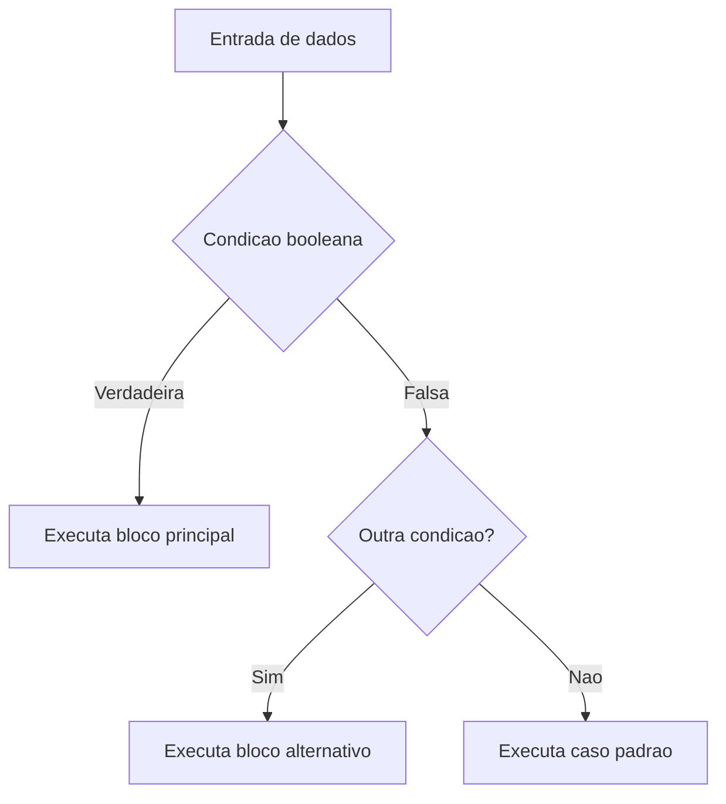

# Estruturas de controle, modularização, estruturas de dados homogêneas e recursividade

## 1. Introdução

Estruturas de controle, mecanismos de modularização, arranjos homogêneos e recursividade formam a base da construção de algoritmos em linguagens imperativas como C. Esses elementos definem, respectivamente, como o fluxo de execução é dirigido, como responsabilidades são particionadas, como coleções homogêneas são representadas em memória e como problemas podem ser resolvidos por decomposição auto-referente. Em conjunto, eles estabelecem a infraestrutura conceitual sobre a qual algoritmos mais sofisticados, estruturas de dados avançadas e sistemas de software robustos são desenvolvidos (Knuth, 1997; Cormen et al., 2009).

Do ponto de vista pedagógico e científico, a compreensão aprofundada desses temas exige articular semântica operacional, custo computacional, implicações de implementação e padrões de uso. Em C, essa discussão torna-se particularmente relevante porque a linguagem expõe detalhes de armazenamento, escopo, passagem de parâmetros e aritmética de ponteiros, permitindo observar com clareza a relação entre abstração algorítmica e comportamento concreto em memória (Ziviani, 2004).

## 2. Fundamentação Teórica

### 2.1 Fluxo de controle e semântica imperativa

Em programação imperativa, o estado do programa é modificado por uma sequência de comandos. Estruturas de controle disciplinam essa sequência, permitindo seleção condicional e repetição. A instrução `if` implementa desvio condicional binário; `if-else if-else` permite encadeamentos hierárquicos de predicado; `switch` oferece despacho multi-ramo com custo lógico geralmente mais legível quando as alternativas são valores discretos de uma expressão inteira ou enumerada (Cormen et al., 2012).

Do ponto de vista formal, essas construções podem ser descritas por funções de transição de estado. A relevância acadêmica reside em que decisões mal modeladas aumentam complexidade ciclomática, reduzem verificabilidade e ampliam risco de erros semânticos, como o clássico problema do dangling else.

### 2.2 Repetição e invariantes de laço

Laços `while`, `do-while` e `for` expressam iteração controlada por predicado, pós-teste ou contador. A análise correta dessas estruturas exige o conceito de invariante de laço: uma propriedade que permanece verdadeira antes e após cada iteração. Invariantes permitem provar correção parcial e total, além de sustentar análises assintóticas rigorosas (Knuth, 1997).

### 2.3 Modularização e abstração procedimental

Funções e procedimentos reduzem acoplamento, aumentam coesão e tornam a prova de correção local. Em C, funções retornam um valor ou `void`, e a interface é declarada por protótipos. A linguagem realiza passagem por valor; a chamada por referência é simulada por meio do repasse de endereços, o que torna explícitas as implicações de aliasing, mutabilidade e custo de cópia (Horowitz; Sahni, 1986).

### 2.4 Estruturas homogêneas e layout de memória

Vetores e matrizes são estruturas homogêneas porque armazenam elementos de mesmo tipo em posições contíguas. Esse arranjo fornece acesso aleatório em tempo constante, mas impõe tamanho fixo em sua forma estática e custo elevado para inserções e remoções internas. Matrizes em C são armazenadas em ordem row-major - ou seja, linha por linha - de modo que a travessia por linhas explora localidade espacial de cache com maior eficiência (Sedgewick, 1998).

### 2.5 Recursividade

Recursividade descreve algoritmos em que a solução de um problema depende de soluções para instâncias menores do mesmo problema. Seus componentes compõem caso base, redução do problema e progresso em direção à parada. Embora elegantemente alinhada à definição de estruturas indutivas, a recursão traz custos de empilhamento, possíveis riscos de estouro de pilha e, em alguns casos, redundância computacional, como em implementações ingênuas de Fibonacci (Cormen et al., 2009).

## 3. Desenvolvimento

### 3.1 Estruturas de decisão

As estruturas de decisão permitem que um algoritmo escolha diferentes caminhos de execução com base na avaliação de condições lógicas. Elas constituem um dos mecanismos fundamentais para o controle de fluxo em programas, possibilitando adaptar o comportamento do sistema de acordo com os dados de entrada ou com o estado da execução.

A estrutura `if` simples é utilizada quando apenas uma ação deve ser executada caso determinada condição seja verdadeira. Trata-se da forma mais elementar de decisão e normalmente apresenta alta legibilidade para verificações pontuais.

Quando existem múltiplos caminhos possíveis, pode-se utilizar cadeias de `if-else if`, nas quais as condições são avaliadas sequencialmente até que uma delas seja satisfeita. Essa abordagem oferece grande flexibilidade, pois cada condição pode envolver expressões distintas. Entretanto, o aumento do número de testes tende a elevar a complexidade do código e dificultar sua manutenção.

A estrutura `switch` é indicada para situações em que uma única variável deve ser comparada com diversos valores discretos. Em muitos casos, ela proporciona maior legibilidade do que longas cadeias de `if-else if`. Dependendo da linguagem e do compilador utilizados, a implementação pode ser otimizada por meio de tabelas de salto (*jump tables*), reduzindo o custo das comparações.

A Figura 1 apresenta um fluxo genérico de tomada de decisão em algoritmos.



A Tabela 1 resume as principais características das estruturas de decisão discutidas.

| Estrutura    | Facilidade de implementação | Facilidade de uso | Desempenho | Consumo de memória | Vantagens                         | Desvantagens                             | Casos de uso                         | Big O lógico |
| ------------ | --------------------------- | ----------------- | ---------- | ------------------ | --------------------------------- | ---------------------------------------- | ------------------------------------ | ------------ |
| `if` simples | Alta                        | Alta              | Excelente  | O(1)               | Clareza para decisão binária      | Escala mal com muitos casos              | Validação simples                    | O(1)         |
| `if-else if` | Alta                        | Média             | Excelente  | O(1)               | Flexível para múltiplas condições | Pode aumentar a complexidade ciclomática | Regras de negócio                    | O(k)         |
| `switch`     | Alta                        | Alta              | Muito bom  | O(1)               | Legibilidade para casos discretos | Menos flexível para expressões complexas | Menus, estados, analisadores léxicos | O(1) a O(k)  |

#### Exemplo 1: classificação de desempenho acadêmico

**Explicação teórica.** O algoritmo classifica uma nota em quatro categorias por decisão múltipla hierárquica. A ordem dos predicados é importante para preservar exclusividade e evitar avaliações redundantes.

**Pseudocódigo**

```text
algoritmo classificar_nota(nota)
    se nota < 0 ou nota > 100 então
        escreva "invalida"
    senao se nota >= 85 então
        escreva "excelente"
    senao se nota >= 70 então
        escreva "boa"
    senao se nota >= 50 então
        escreva "suficiente"
    senao
        escreva "insuficiente"
fim
```

**Implementação completa em C**

```c
#include <stdio.h>

const char *classificar_nota(int nota) {
    if (nota < 0 || nota > 100) {
        return "invalida";
    }

    if (nota >= 85) {
        return "excelente";
    }

    if (nota >= 70) {
        return "boa";
    }

    if (nota >= 50) {
        return "suficiente";
    }

    return "insuficiente";
}

int main(void) {
    int nota = 78;
    printf("Nota %d -> %s\n", nota, classificar_nota(nota));
    return 0;
}
```

**Complexidade.** Tempo $O(1)$, espaço adicional $O(1)$.

**Partes importantes.** A primeira guarda evita estados inválidos; a sequência decrescente de limites elimina sobreposição de casos; o retorno imediato simplifica controle de fluxo.

**Entrada e saída.** Entrada: `78`. Saída: `Nota 78 -> boa`.

**Análise de desempenho.** O custo é constante, mas o número médio de comparações depende da distribuição das notas. Em distribuições concentradas em notas altas, a ordenação atual é favorável.

**Comparação com alternativas.** Uma versão com `switch` não seria adequada porque as faixas de nota são intervalares, não valores discretos isolados.
