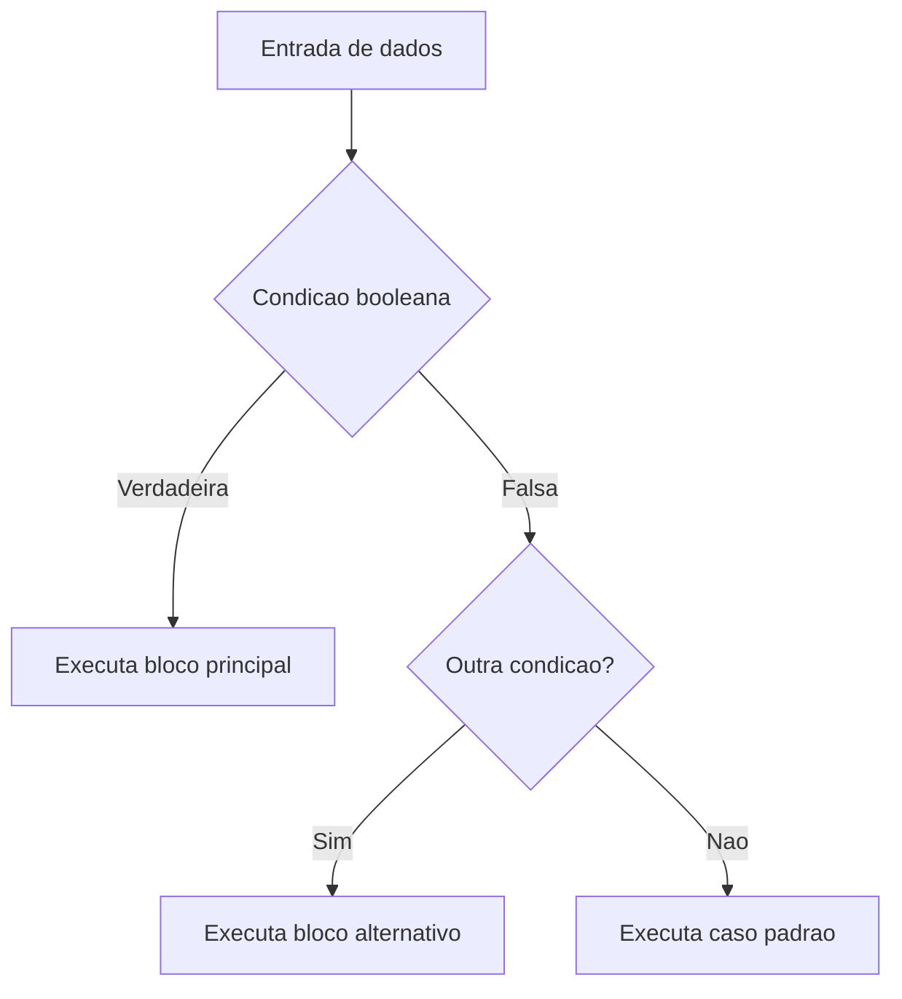

# Estruturas de controle, modularização, estruturas de dados homogêneas e recursividade

## 1. Introdução

Estruturas de controle, mecanismos de modularização, arranjos homogêneos e recursividade formam a base da construção de algoritmos em linguagens imperativas como C. Esses elementos definem, respectivamente, como o fluxo de execução é dirigido, como responsabilidades são particionadas, como coleções homogêneas são representadas em memória e como problemas podem ser resolvidos por decomposição auto-referente. Em conjunto, eles estabelecem a infraestrutura conceitual sobre a qual algoritmos mais sofisticados, estruturas de dados avançadas e sistemas de software robustos são desenvolvidos (Knuth, 1997; Cormen et al., 2009).

Do ponto de vista pedagógico e científico, a compreensão aprofundada desses temas exige articular semântica operacional, custo computacional, implicações de implementação e padrões de uso. Em C, essa discussão torna-se particularmente relevante porque a linguagem expõe detalhes de armazenamento, escopo, passagem de parâmetros e aritmética de ponteiros, permitindo observar com clareza a relação entre abstração algorítmica e comportamento concreto em memória (Ziviani, 2004).

Este artigo examina, em nível compatível com concursos de professor titular e disciplinas avançadas de algoritmos, estruturas de decisão simples, compostas e de múltipla escolha; estruturas de repetição; funções, procedimentos, protótipos e escopo; vetores e matrizes; e recursividade. O texto enfatiza teoria, custo temporal e espacial, casos de uso, armadilhas recorrentes e comparações entre abordagens iterativas e recursivas.

## 2. Fundamentação Teórica

### 2.1 Fluxo de controle e semântica imperativa

Em programação imperativa, o estado do programa é modificado por uma sequência de comandos. Estruturas de controle disciplinam essa sequência, permitindo seleção condicional e repetição. A instrução `if` implementa desvio condicional binário; `if-else if-else` permite encadeamentos hierárquicos de predicados; `switch` oferece despacho multi-ramo com custo lógico geralmente mais legível quando as alternativas são valores discretos de uma expressão inteira ou enumerada (Cormen et al., 2012).

Do ponto de vista formal, essas construções podem ser descritas por funções de transição de estado. A relevância acadêmica reside em que decisões mal modeladas aumentam complexidade ciclomática, reduzem verificabilidade e ampliam risco de erros semânticos, como o clássico problema do dangling else.

### 2.2 Repetição e invariantes de laço

Laços `while`, `do-while` e `for` expressam iteração controlada por predicado, pós-teste ou contador. A análise correta dessas estruturas exige o conceito de invariante de laço: uma propriedade que permanece verdadeira antes e após cada iteração. Invariantes permitem provar correção parcial e total, além de sustentar análises assintóticas rigorosas (Knuth, 1997).

### 2.3 Modularização e abstração procedimental

Funções e procedimentos reduzem acoplamento, aumentam coesão e tornam a prova de correção local. Em C, funções retornam um valor ou `void`, e a interface é declarada por protótipos. A linguagem realiza passagem por valor; a chamada por referência é simulada por meio do repasse de endereços, o que torna explícitas as implicações de aliasing, mutabilidade e custo de cópia (Horowitz; Sahni, 1986).

### 2.4 Estruturas homogêneas e layout de memória

Vetores e matrizes são estruturas homogêneas porque armazenam elementos de mesmo tipo em posições contíguas. Esse arranjo fornece acesso aleatório em tempo constante, mas impõe tamanho fixo em sua forma estática e custo elevado para inserções e remoções internas. Matrizes em C são armazenadas em ordem row-major, de modo que a travessia por linhas explora localidade espacial de cache com maior eficiência (Sedgewick, 1998).

### 2.5 Recursividade

Recursividade descreve algoritmos em que a solução de um problema depende de soluções para instâncias menores do mesmo problema. Seus componentes essenciais são caso base, redução do problema e progresso em direção à parada. Embora elegantemente alinhada à definição de estruturas indutivas, a recursão traz custos de empilhamento de ativações, possíveis riscos de estouro de pilha e, em alguns casos, redundância computacional expressiva, como em implementações ingênuas de Fibonacci (Cormen et al., 2009).

## 3. Desenvolvimento

### 3.1 Estruturas de decisão

As estruturas de decisão podem ser classificadas em simples, composta e múltipla escolha. A escolha entre `if` e `switch` deve considerar expressividade semântica e custo de manutenção.



Tabela 1 sintetiza propriedades operacionais dessas estruturas.

| Estrutura    | Facilidade de implementação | Facilidade de uso | Desempenho | Consumo de memória | Vantagens                               | Desvantagens                           | Casos de uso           | Big O lógico                     |
| ------------ | --------------------------- | ----------------- | ---------- | ------------------ | --------------------------------------- | -------------------------------------- | ---------------------- | -------------------------------- |
| `if` simples | Alta                        | Alta              | Excelente  | O(1)               | Clareza para decisão binária            | Escala mal com muitos casos            | Validação simples      | O(1)                             |
| `if-else if` | Alta                        | Média             | Excelente  | O(1)               | Expressivo para predicados heterogêneos | Pode aumentar complexidade ciclomática | Regras de negócio      | O(k) para k testes               |
| `switch`     | Alta                        | Alta              | Muito bom  | O(1)               | Legibilidade para casos discretos       | Restrito a tipos inteiros/enums        | Menus, tokens, estados | O(1) a O(k), conforme compilador |

#### Exemplo 1: classificação de desempenho acadêmico

**Explicação teórica.** O algoritmo classifica uma nota em quatro categorias por decisão múltipla hierárquica. A ordem dos predicados é importante para preservar exclusividade e evitar avaliações redundantes.

**Pseudocódigo**

```text
algoritmo classificar_nota(nota)
    se nota < 0 ou nota > 100 então
        escreva "invalida"
    senao se nota >= 85 então
        escreva "excelente"
    senao se nota >= 70 então
        escreva "boa"
    senao se nota >= 50 então
        escreva "suficiente"
    senao
        escreva "insuficiente"
fim
```

**Implementação completa em C**

```c
#include <stdio.h>

const char *classificar_nota(int nota) {
    if (nota < 0 || nota > 100) {
        return "invalida";
    }

    if (nota >= 85) {
        return "excelente";
    }

    if (nota >= 70) {
        return "boa";
    }

    if (nota >= 50) {
        return "suficiente";
    }

    return "insuficiente";
}

int main(void) {
    int nota = 78;
    printf("Nota %d -> %s\n", nota, classificar_nota(nota));
    return 0;
}
```

**Complexidade.** Tempo $O(1)$, espaço adicional $O(1)$.

**Partes importantes.** A primeira guarda evita estados inválidos; a sequência decrescente de limites elimina sobreposição de casos; o retorno imediato simplifica controle de fluxo.

**Entrada e saída.** Entrada: `78`. Saída: `Nota 78 -> boa`.

**Análise de desempenho.** O custo é constante, mas o número médio de comparações depende da distribuição das notas. Em distribuições concentradas em notas altas, a ordenação atual é favorável.

**Comparação com alternativas.** Uma versão com `switch` não seria adequada porque as faixas de nota são intervalares, não valores discretos isolados.

### 3.2 Estruturas de repetição

Laços permitem percorrer domínios discretos ou iterar até convergência. A escolha correta depende da previsibilidade do número de iterações.

| Estrutura  | Facilidade de implementação | Facilidade de uso | Desempenho | Consumo de memória | Vantagens                       | Desvantagens                   | Casos de uso                   | Big O das operações principais |
| ---------- | --------------------------- | ----------------- | ---------- | ------------------ | ------------------------------- | ------------------------------ | ------------------------------ | ------------------------------ |
| `while`    | Alta                        | Alta              | Muito bom  | O(1)               | Natural para laços condicionais | Mais propenso a laço infinito  | Leitura até sentinela          | O(n)                           |
| `do-while` | Média                       | Média             | Muito bom  | O(1)               | Garante uma iteração            | Menos comum e menos previsível | Menus e validação              | O(n)                           |
| `for`      | Alta                        | Alta              | Excelente  | O(1)               | Compacto para contagem          | Pode esconder lógica excessiva | Percurso de vetores e matrizes | O(n)                           |

#### Exemplo 2: média e desvio de notas usando vetores

**Explicação teórica.** O algoritmo percorre um vetor duas vezes: a primeira para acumular a soma, a segunda para acumular o erro quadrático. Esse desenho preserva simplicidade e evita dependência de fórmulas numericamente instáveis.

**Pseudocódigo**

```text
algoritmo estatisticas(vetor, n)
    soma <- 0
    para i de 0 ate n - 1 faca
        soma <- soma + vetor[i]
    media <- soma / n

    soma_quadrados <- 0
    para i de 0 ate n - 1 faca
        diferenca <- vetor[i] - media
        soma_quadrados <- soma_quadrados + diferenca * diferenca
    retorne media e variancia
fim
```

**Implementação completa em C**

```c
#include <math.h>
#include <stdio.h>

typedef struct {
    double media;
    double variancia;
} Estatisticas;

Estatisticas calcular_estatisticas(const int valores[], int tamanho) {
    long soma = 0;
    double soma_quadrados = 0.0;
    Estatisticas resultado = {0.0, 0.0};

    for (int indice = 0; indice < tamanho; indice++) {
        soma += valores[indice];
    }

    resultado.media = (double)soma / tamanho;

    for (int indice = 0; indice < tamanho; indice++) {
        double diferenca = valores[indice] - resultado.media;
        soma_quadrados += diferenca * diferenca;
    }

    resultado.variancia = soma_quadrados / tamanho;
    return resultado;
}

int main(void) {
    int notas[] = {65, 70, 78, 88, 91};
    Estatisticas estatisticas = calcular_estatisticas(notas, 5);
    printf("Media = %.2f, variancia = %.2f\n", estatisticas.media, estatisticas.variancia);
    return 0;
}
```

**Complexidade.** Tempo $O(n)$, espaço adicional $O(1)$.

**Partes importantes.** O uso de `const int valores[]` documenta ausência de modificação; `long soma` reduz risco de overflow; o segundo laço explicita o custo linear adicional.

**Entrada e saída.** Entrada: `{65, 70, 78, 88, 91}`. Saída aproximada: `Media = 78.40, variancia = 94.64`.

**Comparação com alternativas.** Um laço único com fórmula incremental pode reduzir leituras, mas aumenta complexidade conceitual e potencial instabilidade numérica.

### 3.3 Funções, procedimentos e passagem de parâmetros

Em C, protótipos definem assinatura e possibilitam verificação estática. O escopo pode ser local de bloco, global de arquivo ou persistente interno com `static`. A linguagem usa passagem por valor, mas ao passar o endereço de uma variável, permite que a função altere o objeto apontado.

```text
Arquivo .h  -> prototipos e contratos
Arquivo .c  -> definicoes e detalhes internos
Chamador    -> envia copias de valores ou enderecos
```

Tabela 3 resume mecanismos de passagem e escopo.

| Mecanismo       | Facilidade de implementação | Facilidade de uso | Desempenho               | Consumo de memória         | Vantagens                                      | Desvantagens                   | Casos de uso                         | Big O |
| --------------- | --------------------------- | ----------------- | ------------------------ | -------------------------- | ---------------------------------------------- | ------------------------------ | ------------------------------------ | ----- |
| Por valor       | Alta                        | Alta              | Muito bom                | O(1) por argumento escalar | Segurança contra efeitos colaterais acidentais | Cópia de estruturas grandes    | Parâmetros escalares                 | O(1)  |
| Por endereço    | Média                       | Média             | Muito bom                | O(1)                       | Permite múltiplos resultados                   | Exige disciplina com ponteiros | Saídas múltiplas, mutação controlada | O(1)  |
| Variável local  | Alta                        | Alta              | Excelente                | Stack local                | Isolamento                                     | Vida curta                     | Cálculo intermediário                | O(1)  |
| Variável global | Alta                        | Alta inicialmente | Pode degradar manutenção | Segmento global            | Acesso simples                                 | Alto acoplamento               | Estados globais raros                | O(1)  |
| `static` local  | Média                       | Média             | Excelente                | Segmento estático          | Preserva estado entre chamadas                 | Dificulta reentrância          | Contadores, caches simples           | O(1)  |

### 3.4 Vetores e matrizes

Vetores fornecem acesso aleatório $O(1)$, sendo apropriados para busca indexada e armazenamento compacto. Matrizes generalizam a mesma ideia a múltiplas dimensões. Em termos de custo, o percurso completo de vetor tem tempo $O(n)$; o de matriz $n \times m$, tempo $O(nm)$.

```text
Vetor:   [a0][a1][a2][a3]
Indice:    0   1   2   3

Matriz 3x3 em row-major:
[a00][a01][a02][a10][a11][a12][a20][a21][a22]
```

#### Exemplo 3: multiplicação de matrizes

**Explicação teórica.** A multiplicação clássica de matrizes $A_{n \times p}$ e $B_{p \times m}$ calcula cada elemento $C[i][j]$ como o produto interno entre a linha $i$ de $A$ e a coluna $j$ de $B$. Esse algoritmo evidencia o papel de laços aninhados e a importância do layout de memória.

**Pseudocódigo**

```text
algoritmo multiplicar_matrizes(A, B, C, n, p, m)
    para i de 0 ate n - 1 faca
        para j de 0 ate m - 1 faca
            C[i][j] <- 0
            para k de 0 ate p - 1 faca
                C[i][j] <- C[i][j] + A[i][k] * B[k][j]
fim
```

**Implementação completa em C**

```c
#include <stdio.h>

#define LINHAS_A 2
#define COLUNAS_A 3
#define COLUNAS_B 2

void multiplicar_matrizes(const int a[LINHAS_A][COLUNAS_A],
                         const int b[COLUNAS_A][COLUNAS_B],
                         int c[LINHAS_A][COLUNAS_B]) {
    for (int i = 0; i < LINHAS_A; i++) {
        for (int j = 0; j < COLUNAS_B; j++) {
            c[i][j] = 0;
            for (int k = 0; k < COLUNAS_A; k++) {
                c[i][j] += a[i][k] * b[k][j];
            }
        }
    }
}

int main(void) {
    int a[LINHAS_A][COLUNAS_A] = {{1, 2, 3}, {4, 5, 6}};
    int b[COLUNAS_A][COLUNAS_B] = {{7, 8}, {9, 10}, {11, 12}};
    int c[LINHAS_A][COLUNAS_B];

    multiplicar_matrizes(a, b, c);

    for (int i = 0; i < LINHAS_A; i++) {
        for (int j = 0; j < COLUNAS_B; j++) {
            printf("%d ", c[i][j]);
        }
        printf("\n");
    }

    return 0;
}
```

**Complexidade.** Tempo $O(npm)$; espaço adicional $O(1)$ além da matriz de saída. Em matrizes quadradas $n \times n$, o custo é $O(n^3)$.

**Partes importantes.** A assinatura explicita dimensões em compile time; o acumulador `c[i][j]` precisa ser inicializado antes do laço interno; o laço em `k` representa o produto interno.

**Entrada e saída.** Para as matrizes dadas, a saída é:

```text
58 64
139 154
```

**Comparação com alternativas.** Algoritmos como Strassen reduzem complexidade assintótica, mas possuem maior constante oculta e só são vantajosos em matrizes grandes e contextos especializados.

### 3.5 Recursividade

Recursão é especialmente eficaz quando o problema possui definição indutiva natural. Entretanto, nem toda formulação recursiva é computacionalmente adequada.

#### Exemplo 4: soma recursiva de vetor

**Explicação teórica.** A soma de um vetor pode ser definida como o primeiro elemento mais a soma do sufixo restante. Esse padrão ilustra decomposição estrutural simples e custo linear.

**Pseudocódigo**

```text
algoritmo soma_recursiva(vetor, n)
    se n = 0 então
        retorne 0
    retorne vetor[n - 1] + soma_recursiva(vetor, n - 1)
fim
```

**Implementação completa em C**

```c
#include <stdio.h>

int soma_recursiva(const int valores[], int tamanho) {
    if (tamanho == 0) {
        return 0;
    }

    return valores[tamanho - 1] + soma_recursiva(valores, tamanho - 1);
}

int main(void) {
    int valores[] = {4, 8, 15, 16, 23, 42};
    printf("Soma = %d\n", soma_recursiva(valores, 6));
    return 0;
}
```

**Complexidade.** Tempo $O(n)$, espaço adicional $O(n)$ devido à profundidade recursiva. Melhor, médio e pior caso coincidem, pois a estrutura de chamadas é fixa para um dado `n`.

**Partes importantes.** O caso base `tamanho == 0` garante parada; a redução monotônica `tamanho - 1` assegura progresso; a profundidade recursiva máxima é `n`.

**Entrada e saída.** Entrada: `{4, 8, 15, 16, 23, 42}`. Saída: `Soma = 108`.

**Análise de desempenho.** Em relação à versão iterativa, a recursiva tem a mesma ordem temporal, porém maior consumo de pilha e overhead de chamada.

**Comparação com abordagens alternativas.** A versão iterativa é preferível em produção quando se deseja minimizar uso de stack. A formulação recursiva, contudo, é mais alinhada a provas por indução e a problemas hierárquicos.

## 4. Exemplos, Aplicações e Estudos de Caso

Em sistemas embarcados, estruturas de controle simples e vetores estáticos são preferidos por previsibilidade temporal e baixo custo de alocação. Em computação científica, matrizes dominam a representação de sistemas lineares, imagens e malhas numéricas. Em compiladores e interpretadores, recursividade é central na descida recursiva para análise sintática. Em software corporativo, modularização adequada é requisito de testabilidade, reuso e manutenibilidade.

Um estudo de caso didático relevante é o processamento de notas de uma turma: decisões classificam desempenho, laços percorrem registros, vetores armazenam notas, funções encapsulam cálculo de métricas, e recursividade pode ser explorada para operações agregadas. O ganho pedagógico reside em integrar conceitos fundamentais em um mesmo pipeline algorítmico.

## 5. Comparações e Análises

Tabela 4 consolida comparações entre abordagens estruturais recorrentes.

| Abordagem         | Facilidade de implementação | Facilidade de uso | Desempenho                    | Consumo de memória  | Vantagens                        | Desvantagens                            | Casos de uso                  | Big O típico       |
| ----------------- | --------------------------- | ----------------- | ----------------------------- | ------------------- | -------------------------------- | --------------------------------------- | ----------------------------- | ------------------ |
| Decisão encadeada | Alta                        | Média             | Muito bom                     | O(1)                | Flexível                         | Menos legível para muitos casos         | Classificação por intervalos  | O(k)               |
| `switch`          | Alta                        | Alta              | Muito bom                     | O(1)                | Estrutura clara para estados     | Não serve para intervalos arbitrários   | Menus e autômatos             | O(1) a O(k)        |
| Iteração          | Alta                        | Alta              | Excelente                     | O(1)                | Eficiência operacional           | Menor aderência a estruturas recursivas | Varreduras lineares           | O(n), O(nm)        |
| Recursão          | Média                       | Média             | Variável                      | O(profundidade)     | Elegância e aderência estrutural | Risco de stack overflow                 | Árvores, divide-and-conquer   | O(n) a exponencial |
| Vetor             | Alta                        | Alta              | Excelente em acesso           | Contíguo e compacto | Cache-friendly                   | Inserções internas custosas             | Coleções indexadas            | Acesso O(1)        |
| Matriz            | Média                       | Média             | Excelente para acesso regular | O(nm)               | Representação natural de grade   | Alto custo espacial                     | Álgebra linear, grafos densos | Acesso O(1)        |

Entre as armadilhas mais comuns destacam-se: erro off-by-one em laços, ausência de caso base em recursão, uso indevido de variáveis globais, passagem de ponteiros inválidos, e percursos de matriz que desconsideram localidade de memória. Em termos de otimização, recomenda-se ordenar predicados por frequência esperada, preferir passagem por valor para escalares, usar `const` para contratos imutáveis e substituir recursão profunda por iteração quando a pilha for um recurso crítico.

## 6. Conclusão

Estruturas de controle, modularização, vetores, matrizes e recursividade não constituem apenas tópicos introdutórios; eles definem princípios permanentes da engenharia de algoritmos. A qualidade de soluções mais avançadas depende diretamente da maturidade com que essas bases são dominadas. Em C, esse domínio exige compreender simultaneamente abstração e concretude: semântica do algoritmo, contratos funcionais, organização modular, custo assintótico, layout de memória e implicações do modelo de execução.

A análise comparativa desenvolvida neste artigo mostra que não existe escolha universalmente superior entre iteração e recursão, `if` e `switch`, ou vetores e matrizes em todos os contextos. A decisão correta decorre da estrutura do problema, do ambiente de execução, das metas de desempenho e da necessidade de clareza formal. Esse discernimento, e não apenas a memorização de sintaxe, é o que distingue formação avançada em algoritmos.

## 7. Referências

CORMEN, Thomas H.; LEISERSON, Charles E.; RIVEST, Ronald L.; STEIN, Clifford. Introduction to Algorithms. 3rd ed. Cambridge: MIT Press, 2009.

CORMEN, Thomas H.; LEISERSON, Charles E.; RIVEST, Ronald L.; STEIN, Clifford. Algoritmos: teoria e prática. Rio de Janeiro: Elsevier, 2012.

HOROWITZ, Ellis; SAHNI, Sartaj. Fundamentos de Estruturas de Dados. Rio de Janeiro: Campus, 1986.

KNUTH, Donald E. The Art of Computer Programming. Volume 1: Fundamental Algorithms. 3rd ed. Reading: Addison-Wesley, 1997.

SEDGEWICK, Robert. Algorithms in C, Parts 1-4: Fundamentals, Data Structures, Sorting, Searching. 3rd ed. Reading: Addison-Wesley, 1998.

ZIVIANI, Nivio. Projeto de Algoritmos: com Implementações em Pascal e C. São Paulo: Cengage Learning, 2004.