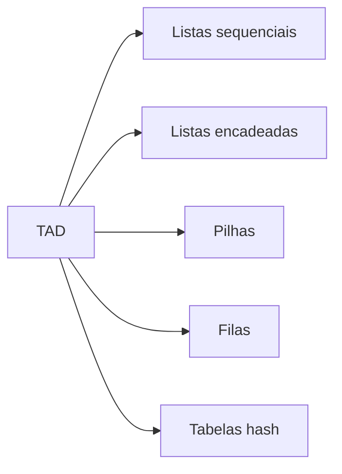

# Tipos abstratos de dados

## 1. Introdução

Tipos abstratos de dados (TADs) constituem um dos principais conceitos da ciência da computação porque separam a especificação lógica das operações de sua realização em memória. Essa separação permite raciocínio algorítmico, encapsulamento, substituição de implementações e manutenção evolutiva de software. Em termos formais, um TAD é definido por um conjunto de valores e por operações semanticamente válidas sobre esse conjunto, independentemente do modo como tais valores são armazenados (Horowitz; Sahni, 1986; Cormen et al., 2009).

Na prática, listas, pilhas, filas e tabelas hash ilustram diferentes comportamentos entre acesso, atualização, consumo de memória e custo de implementação. Em C, a discussão adquire profundidade maior, pois o programador controla explicitamente arranjos estáticos, alocação dinâmica, ponteiros, desalocação e organização modular em arquivos de interface e implementação. Por essa razão, o estudo de TADs em C é simultaneamente um exercício de modelagem abstrata e de implementações de baixo nível.

## 2. Fundamentação Teórica

### 2.1 Interface e implementação

A essência do TAD reside em esconder detalhes internos e expor apenas operações válidas. Em um módulo bem definido, o usuário conhece contratos como inserir, remover, buscar, empilhar ou desenfileirar, mas não depende da forma interna da estrutura. Essa separação permite trocar uma lista sequencial por uma encadeada sem alterar clientes, desde que a interface permaneça igual (Ziviani, 2004).

### 2.2 Estruturas estáticas e dinâmicas

Estruturas estáticas usam memória de tamanho fixo, normalmente baseada em vetores. São previsíveis e cache-friendly, porém limitadas em capacidade. Estruturas dinâmicas usam heap e ponteiros para crescer ou encolher em tempo de execução, ganhando flexibilidade ao custo de maior overhead, fragmentação e complexidade de gerenciamento (Sedgewick, 1998).

### 2.3 Listas, pilhas, filas e hashing

Listas são estruturas lineares utilizadas para armazenar coleções de elementos em sequência, permitindo inserções, remoções e percursos ordenados. Dependendo da implementação, podem ser baseadas em arranjos contíguos ou nós encadeados, oferecendo diferentes comportamentos entre acesso aleatório e flexibilidade de atualização.

Pilhas (*stacks*) seguem o conceito LIFO (*Last In, First Out*), na qual o último elemento inserido é o primeiro a ser removido. Essa estrutura é amplamente utilizada em chamadas recursivas, avaliação de expressões, algoritmos de retrocesso (*backtracking*) e gerenciamento de memória de execução.

Filas (*queues*) seguem o conceito FIFO (*First In, First Out*), em que o primeiro elemento inserido é o primeiro a ser removido. São empregadas em escalonamento de processos, sistemas de atendimento, buffers de comunicação e algoritmos de busca em largura (BFS).

Tabelas hash (*hash tables*) armazenam elementos por meio de uma função de dispersão (*hash function*), que transforma uma chave em uma posição de armazenamento. Quando a função hash distribui adequadamente os dados e o fator de carga permanece controlado, operações de busca, inserção e remoção apresentam custo médio próximo de $O(1)$. Em contrapartida, colisões podem ocorrer quando múltiplas chaves são mapeadas para a mesma posição, exigindo estratégias de tratamento como encadeamento separado ou endereçamento aberto (Cormen et al., 2012).

## 3. Desenvolvimento



### 3.1 Listas estáticas e sequenciais

Listas sequenciais estáticas armazenam elementos em vetor contíguo. O acesso por índice é $O(1)$, mas inserções e remoções no meio exigem deslocamentos lineares.

| Estrutura      | Facilidade de implementação | Facilidade de uso | Desempenho          | Consumo de memória | Vantagens                          | Desvantagens    | Casos de uso                       | Big O principal                                |
| -------------- | --------------------------- | ----------------- | ------------------- | ------------------ | ---------------------------------- | --------------- | ---------------------------------- | ---------------------------------------------- |
| Lista estática | Alta                        | Alta              | Excelente em acesso | Baixo e previsível | Simplicidade e localidade de cache | Capacidade fixa | Tabelas pequenas, buffers estáveis | Busca O(n), acesso O(1), inserção interna O(n) |

#### Algoritmo 1: inserção ordenada em lista sequencial

**Explicação teórica.** Manter a lista ordenada reduz custo de futuras buscas binárias, mas a inserção exige localizar a posição e deslocar elementos para abrir espaço.

**Pseudocódigo**

```text
algoritmo inserir_ordenado(lista, tamanho, capacidade, valor)
    se tamanho = capacidade então retorne falso
    i <- tamanho - 1
    enquanto i >= 0 e lista[i] > valor faca
        lista[i + 1] <- lista[i]
        i <- i - 1
    lista[i + 1] <- valor
    tamanho <- tamanho + 1
    retorne verdadeiro
fim
```

**Implementação completa em C**

```c
#include <stdio.h>

#define CAPACIDADE 16

typedef struct {
    int dados[CAPACIDADE];
    int tamanho;
} ListaEstatica;

void lista_inicializar(ListaEstatica *lista) {
    lista->tamanho = 0;
}

int lista_buscar(const ListaEstatica *lista, int valor) {
    for (int indice = 0; indice < lista->tamanho; indice++) {
        if (lista->dados[indice] == valor) {
            return indice;
        }
    }
    return -1;
}

int lista_inserir_ordenado(ListaEstatica *lista, int valor) {
    if (lista->tamanho == CAPACIDADE) {
        return 0;
    }

    int indice = lista->tamanho - 1;
    while (indice >= 0 && lista->dados[indice] > valor) {
        lista->dados[indice + 1] = lista->dados[indice];
        indice--;
    }

    lista->dados[indice + 1] = valor;
    lista->tamanho++;
    return 1;
}

int lista_remover(ListaEstatica *lista, int valor) {
    int posicao = lista_buscar(lista, valor);
    if (posicao < 0) {
        return 0;
    }

    for (int indice = posicao; indice < lista->tamanho - 1; indice++) {
        lista->dados[indice] = lista->dados[indice + 1];
    }

    lista->tamanho--;
    return 1;
}
```

**Complexidade.** Busca $O(n)$; inserção e remoção no pior caso $O(n)$; acesso por índice $O(1)$; espaço $O(n)$ pré-alocado.

**Partes importantes.** O deslocamento é executado de trás para frente para não sobrescrever dados; o tamanho lógico é independente da capacidade física; a remoção reutiliza busca linear.

**Entrada e saída.** Inserindo `7, 3, 9, 5`, a lista final permanece `3 5 7 9`.

**Comparação com alternativas.** Em relação à lista encadeada, a lista estática perde em inserção no início, mas ganha em localidade de cache e simplicidade de depuração.

### 3.2 Listas dinâmicas e encadeadas

Listas encadeadas representam cada elemento como nó com referência ao próximo. A principal vantagem é remover dependência de capacidade fixa e permitir inserções locais com custo constante quando a posição já é conhecida.

| Estrutura       | Facilidade de implementação | Facilidade de uso | Desempenho                | Consumo de memória  | Vantagens                | Desvantagens         | Casos de uso                       | Big O principal                     |
| --------------- | --------------------------- | ----------------- | ------------------------- | ------------------- | ------------------------ | -------------------- | ---------------------------------- | ----------------------------------- |
| Lista encadeada | Média                       | Média             | Bom para inserções locais | Maior por ponteiros | Flexibilidade estrutural | Sem acesso aleatório | Filas, pilhas, dicionários simples | Busca O(n), inserção no início O(1) |

#### Algoritmo 2: inserção e remoção em lista simplesmente encadeada

**Pseudocódigo**

```text
algoritmo inserir_inicio(cabeca, valor)
    novo <- aloque no
    novo.valor <- valor
    novo.proximo <- cabeca
    cabeca <- novo
fim

algoritmo remover_valor(cabeca, valor)
    percorra mantendo anterior e atual
    quando encontrar valor, religue anterior ao proximo
fim
```

**Implementação completa em C**

```c
#include <stdlib.h>

typedef struct No {
    int valor;
    struct No *proximo;
} No;

No *lista_encadeada_inserir_inicio(No *cabeca, int valor) {
    No *novo_no = (No *)malloc(sizeof(No));
    if (novo_no == NULL) {
        return cabeca;
    }

    novo_no->valor = valor;
    novo_no->proximo = cabeca;
    return novo_no;
}

No *lista_encadeada_remover(No *cabeca, int valor) {
    No *anterior = NULL;
    No *atual = cabeca;

    while (atual != NULL && atual->valor != valor) {
        anterior = atual;
        atual = atual->proximo;
    }

    if (atual == NULL) {
        return cabeca;
    }

    if (anterior == NULL) {
        cabeca = atual->proximo;
    } else {
        anterior->proximo = atual->proximo;
    }

    free(atual);
    return cabeca;
}

int lista_encadeada_buscar(const No *cabeca, int valor) {
    while (cabeca != NULL) {
        if (cabeca->valor == valor) {
            return 1;
        }
        cabeca = cabeca->proximo;
    }
    return 0;
}
```

**Complexidade.** Busca e remoção por valor $O(n)$; inserção no início $O(1)$; espaço $O(n)$ acrescido de ponteiros.

**Explicação das partes relevantes.** O ponteiro `anterior` é necessário para reencadear a lista na remoção; o caso em que o nó removido é a cabeça demanda tratamento especial; a desalocação imediata evita vazamento de memória.

### 3.3 Pilhas

Pilhas obedecem à política LIFO, sendo fundamentais em chamada de funções, backtracking, avaliação de expressões e análise sintática.

**Pseudocódigo**

```text
algoritmo push(pilha, valor)
    se pilha cheia então retorne falso
    pilha[topo + 1] <- valor
    topo <- topo + 1
    retorne verdadeiro

algoritmo pop(pilha)
    se pilha vazia então retorne falso
    valor <- pilha[topo]
    topo <- topo - 1
    retorne valor
```

#### Algoritmo 3: pilha estática baseada em vetor

**Implementação completa em C**

```c
#define PILHA_MAX 32

typedef struct {
    int dados[PILHA_MAX];
    int topo;
} Pilha;

void pilha_inicializar(Pilha *pilha) {
    pilha->topo = -1;
}

int pilha_vazia(const Pilha *pilha) {
    return pilha->topo == -1;
}

int pilha_empilhar(Pilha *pilha, int valor) {
    if (pilha->topo == PILHA_MAX - 1) {
        return 0;
    }
    pilha->dados[++pilha->topo] = valor;
    return 1;
}

int pilha_desempilhar(Pilha *pilha, int *valor_saida) {
    if (pilha_vazia(pilha)) {
        return 0;
    }
    *valor_saida = pilha->dados[pilha->topo--];
    return 1;
}
```

**Complexidade.** `push`, `pop` e `top` em $O(1)$; memória $O(n)$ fixa.

**Entrada e saída.** Empilhando `10, 20, 30`, três remoções devolvem `30, 20, 10`.

**Comparação com abordagens alternativas.** A pilha encadeada elimina capacidade fixa, mas aumenta custo por nó e fragmentação potencial.

### 3.4 Filas

Filas modelam atendimento em ordem de chegada. Uma implementação eficiente em vetor deve ser circular, evitando deslocamentos lineares.

**Pseudocódigo**

```text
algoritmo enqueue(fila, valor)
    se fila cheia então retorne falso
    fila[dados][fim] <- valor
    fim <- (fim + 1) mod capacidade
    quantidade <- quantidade + 1
    retorne verdadeiro

algoritmo dequeue(fila)
    se fila vazia então retorne falso
    valor <- fila[dados][inicio]
    inicio <- (inicio + 1) mod capacidade
    quantidade <- quantidade - 1
    retorne valor
```

#### Algoritmo 4: fila circular

**Implementação completa em C**

```c
#define FILA_MAX 32

typedef struct {
    int dados[FILA_MAX];
    int inicio;
    int fim;
    int quantidade;
} Fila;

void fila_inicializar(Fila *fila) {
    fila->inicio = 0;
    fila->fim = 0;
    fila->quantidade = 0;
}

int fila_enfileirar(Fila *fila, int valor) {
    if (fila->quantidade == FILA_MAX) {
        return 0;
    }
    fila->dados[fila->fim] = valor;
    fila->fim = (fila->fim + 1) % FILA_MAX;
    fila->quantidade++;
    return 1;
}

int fila_desenfileirar(Fila *fila, int *valor_saida) {
    if (fila->quantidade == 0) {
        return 0;
    }
    *valor_saida = fila->dados[fila->inicio];
    fila->inicio = (fila->inicio + 1) % FILA_MAX;
    fila->quantidade--;
    return 1;
}
```

**Complexidade.** `enqueue` e `dequeue` em $O(1)$; espaço $O(n)$ fixo.

**Partes importantes.** O operador módulo implementa circularidade; `quantidade` distingue fila vazia de fila cheia quando `inicio == fim`.

### 3.5 Tabelas hash

Tabelas hash armazenam pares chave-valor associando cada chave a uma posição calculada por uma função de dispersão (*hash function*). O objetivo é obter operações de busca, inserção e remoção em tempo próximo de constante. O desempenho depende da qualidade da função hash, da estratégia de tratamento de colisões e do fator de carga $\alpha = n/m$, sendo $n$ o número de elementos armazenados e $m$ o número de posições da tabela.

Colisões ocorrem quando duas ou mais chaves são mapeadas para a mesma posição. Como colisões são inevitáveis em aplicações práticas, diferentes estratégias foram desenvolvidas para tratá-las.

| Estrutura                      | Facilidade de implementação | Facilidade de uso | Desempenho                   | Consumo de memória | Vantagens                        | Desvantagens                                 | Casos de uso                | Big O principal           |
| ------------------------------ | --------------------------- | ----------------- | ---------------------------- | ------------------ | -------------------------------- | -------------------------------------------- | --------------------------- | ------------------------- |
| Hash com encadeamento separado | Média                       | Alta              | Excelente em média           | Moderado           | Simples e flexível               | Uso adicional de memória                     | Dicionários, caches         | Médio $O(1)$, pior $O(n)$ |
| Hash com sondagem linear       | Alta                        | Alta              | Muito bom com baixa ocupação | Baixo              | Estrutura compacta               | Sofre agrupamento primário                   | Sistemas embarcados         | Médio $O(1)$, pior $O(n)$ |
| Hash com sondagem quadrática   | Média                       | Média             | Bom                          | Baixo              | Reduz agrupamentos               | Pode dificultar cobertura completa da tabela | Tabelas estáticas           | Médio $O(1)$, pior $O(n)$ |
| Hash duplo (*double hashing*)  | Média                       | Média             | Excelente                    | Baixo              | Menor incidência de agrupamentos | Implementação mais complexa                  | Sistemas de alto desempenho | Médio $O(1)$, pior $O(n)$ |

#### Encadeamento separado

No encadeamento separado (*separate chaining*), cada posição da tabela aponta para uma lista ou coleção de elementos que compartilham o mesmo índice hash. Quando ocorre uma colisão, o novo elemento é inserido na estrutura associada ao balde correspondente.

**Pseudocódigo**

```text
algoritmo hash_inserir(tabela, valor)
    indice <- hash(valor)
    insira valor na lista do balde indice
fim
```

#### Sondagem linear

Na sondagem linear (*linear probing*), todos os elementos permanecem dentro da própria tabela. Quando ocorre colisão, procura-se sequencialmente a próxima posição livre.

**Pseudocódigo**

```text
algoritmo hash_inserir(tabela, valor)
    indice <- hash(valor)

    enquanto tabela[indice] estiver ocupada faça
        indice <- (indice + 1) mod tamanho_tabela
    fim

    tabela[indice] <- valor
fim
```

#### Sondagem quadrática

A sondagem quadrática (*quadratic probing*) utiliza deslocamentos quadráticos para reduzir o agrupamento de elementos.

**Pseudocódigo**

```text
algoritmo hash_inserir(tabela, valor)
    indice <- hash(valor)
    i <- 1

    enquanto tabela[indice] estiver ocupada faça
        indice <- (hash(valor) + i²) mod tamanho_tabela
        i <- i + 1
    fim

    tabela[indice] <- valor
fim
```

#### Hash duplo

O hash duplo (*double hashing*) utiliza uma segunda função hash para determinar a sequência de sondagem, reduzindo significativamente a formação de agrupamentos.

**Pseudocódigo**

```text
algoritmo hash_inserir(tabela, valor)
    h1 <- hash1(valor)
    h2 <- hash2(valor)  
    i <- 0

    enquanto tabela[(h1 + i*h2) mod tamanho_tabela] estiver ocupada faça
        i <- i + 1
    fim

    tabela[(h1 + i*h2) mod tamanho_tabela] <- valor
fim
```

Em cenários médios, tabelas hash bem dimensionadas oferecem operações de busca, inserção e remoção em tempo esperado $O(1)$, tornando-se uma das estruturas mais utilizadas na implementação de mapas, dicionários, índices e mecanismos de cache.

#### Algoritmo 5: hash com encadeamento separado

**Implementação completa em C**

```c
#include <stdlib.h>

#define HASH_TAMANHO 11

typedef struct EntradaHash {
    int chave;
    struct EntradaHash *proximo;
} EntradaHash;

typedef struct {
    EntradaHash *baldes[HASH_TAMANHO];
} TabelaHash;

int hash_funcao(int chave) {
    return chave % HASH_TAMANHO;
}

void hash_inicializar(TabelaHash *tabela) {
    for (int indice = 0; indice < HASH_TAMANHO; indice++) {
        tabela->baldes[indice] = NULL;
    }
}

void hash_inserir(TabelaHash *tabela, int chave) {
    int indice = hash_funcao(chave);
    EntradaHash *nova_entrada = (EntradaHash *)malloc(sizeof(EntradaHash));
    if (nova_entrada == NULL) {
        return;
    }

    nova_entrada->chave = chave;
    nova_entrada->proximo = tabela->baldes[indice];
    tabela->baldes[indice] = nova_entrada;
}

int hash_buscar(const TabelaHash *tabela, int chave) {
    int indice = hash_funcao(chave);
    EntradaHash *atual = tabela->baldes[indice];

    while (atual != NULL) {
        if (atual->chave == chave) {
            return 1;
        }
        atual = atual->proximo;
    }
    return 0;
}

int hash_remover(TabelaHash *tabela, int chave) {
    int indice = hash_funcao(chave);
    EntradaHash *anterior = NULL;
    EntradaHash *atual = tabela->baldes[indice];

    while (atual != NULL && atual->chave != chave) {
        anterior = atual;
        atual = atual->proximo;
    }

    if (atual == NULL) {
        return 0;
    }

    if (anterior == NULL) {
        tabela->baldes[indice] = atual->proximo;
    } else {
        anterior->proximo = atual->proximo;
    }

    free(atual);
    return 1;
}
```

**Complexidade.** Média $O(1)$ para inserção, busca e remoção; pior caso $O(n)$ com colisões degeneradas; espaço $O(m + n)$.

**Análise de desempenho.** Em cenários reais, o fator de carga e a distribuição das chaves determinam a diferença entre comportamento quase constante e degradação linear. Redimensionamento dinâmico melhora robustez, mas aumenta complexidade da implementação.

## 4. Exemplos, Aplicações e Estudos de Caso

Listas sequenciais são frequentes em estruturas de registros com cardinalidade (qtde elementos) máxima conhecida, como tabelas internas de compiladores simples ou buffers de entrada. Listas encadeadas aparecem em listas de adjacência, free lists e estruturas em que inserções locais são dominantes. Pilhas sustentam o mecanismo de chamadas, avaliação de expressões pós-fixas e algoritmos de retrocesso. Filas aparecem em escalonamento, BFS e pipelines. Tabelas hash são onipresentes em índices de bancos, caches, tabelas de símbolos e sistemas distribuídos.

Um estudo de caso clássico é um processador de requisições web: fila para enfileirar pedidos, tabela hash para mapear sessões, pilha para análise sintática de templates e lista encadeada para encadear colisões de cache. Esse cenário evidencia que TADs raramente operam isoladamente; eles compõem arquiteturas maiores.

## 5. Comparações e Análises

| Estrutura        | Facilidade de implementação | Facilidade de uso | Desempenho                 | Consumo de memória | Vantagens             | Desvantagens           | Casos de uso         | Big O das operações principais  |
| ---------------- | --------------------------- | ----------------- | -------------------------- | ------------------ | --------------------- | ---------------------- | -------------------- | ------------------------------- |
| Lista sequencial | Alta                        | Alta              | Excelente para acesso      | Baixo              | Acesso direto         | Inserção/remoção caras | Catálogos indexados  | Acesso O(1), inserção O(n)      |
| Lista encadeada  | Média                       | Média             | Boa em atualizações locais | Médio/alto         | Flexível              | Busca linear           | Listas de adjacência | Busca O(n), inserção local O(1) |
| Pilha            | Alta                        | Alta              | Excelente                  | Baixo              | LIFO simples          | Restrita ao topo       | Backtracking         | `push`/`pop` O(1)               |
| Fila circular    | Média                       | Alta              | Excelente                  | Baixo              | FIFO sem deslocamento | Capacidade fixa        | Escalonamento        | `enqueue`/`dequeue` O(1)        |
| Hash             | Média                       | Alta              | Excelente em média         | Moderado           | Busca quase constante | Sensível a colisões    | Índices associativos | Médio O(1), pior O(n)           |

Armadilhas recorrentes incluem ponteiros pendentes após remoção, uso de memória não inicializada, vazamentos por ausência de `free`, confusão entre tamanho lógico e capacidade física e desenho inadequado de funções hash. Em otimização, recomenda-se usar listas sequenciais quando localidade de cache é crucial, optar por filas circulares para evitar deslocamentos e controlar fator de carga em tabelas hash com redimensionamento.

## 6. Conclusão

O estudo de tipos abstratos de dados mostra que desempenho não decorre apenas da ordem assintótica, mas da compatibilidade entre operação dominante, organização da memória e perfil do problema. Estruturas sequenciais, encadeadas, LIFO, FIFO e hash oferecem diferentes comportamentos entre simplicidade, flexibilidade e custo operacional. A maturidade em algoritmos exige reconhecer tais comportamentos e selecionar a representação mais adequada à carga de trabalho esperada.

## 7. Referências

CORMEN, Thomas H.; LEISERSON, Charles E.; RIVEST, Ronald L.; STEIN, Clifford. Introduction to Algorithms. 3rd ed. Cambridge: MIT Press, 2009.

CORMEN, Thomas H.; LEISERSON, Charles E.; RIVEST, Ronald L.; STEIN, Clifford. Algoritmos: teoria e prática. Rio de Janeiro: Elsevier, 2012.

HOROWITZ, Ellis; SAHNI, Sartaj. Fundamentos de Estruturas de Dados. Rio de Janeiro: Campus, 1986.

SEDGEWICK, Robert. Algorithms in C, Parts 1-4: Fundamentals, Data Structures, Sorting, Searching. 3rd ed. Reading: Addison-Wesley, 1998.

ZIVIANI, Nivio. Projeto de Algoritmos: com Implementações em Pascal e C. São Paulo: Cengage Learning, 2004.
