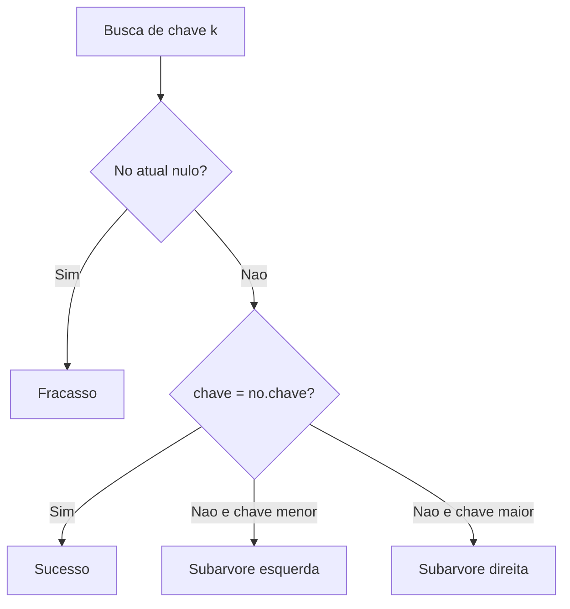

# Árvores de pesquisa e seus algoritmos

## 1. Introdução

Árvores de pesquisa ocupam posição central na organização eficiente de dados ordenáveis. Elas suportam busca, inserção e remoção de forma hierárquica e, quando balanceadas, aproximam-se do limite informacional ótimo para operações de dicionário. A relevância acadêmica dessas estruturas decorre do fato de que elas conectam fundamentos combinatórios, provas de corretude, análise probabilística e engenharia de armazenamento secundário (Cormen et al., 2009; Knuth, 1998).

Além das árvores binárias e árvores binárias de busca, o ecossistema inclui variantes auto-balanceadas como AVL e Red-Black Trees, bem como árvores multiway como B-Trees, fundamentais em sistemas de arquivos e bancos de dados. Cada família materializa um compromisso diferente entre rigidez de balanceamento, custo de atualização, localidade em memória e adequação a hierarquias de armazenamento.

## 2. Fundamentação Teórica

### 2.1 Conceitos básicos

Uma árvore é um grafo conexo e acíclico. Em árvores enraizadas, cada nó possui um pai, exceto a raiz, e zero ou mais filhos. A altura influencia diretamente o custo de operações de pesquisa. Em árvores de busca, a relação de ordem entre chaves permite decidir localmente o próximo ramo a seguir, reduzindo o espaço de busca a cada passo.

### 2.2 Balanceamento

Se a altura de uma árvore binária de busca degenera para $n - 1$, as operações tornam-se lineares. O objetivo de estruturas balanceadas é restringir a altura para $\Theta(\log n)$. AVL faz isso com critério rígido de diferença de alturas. Red-Black Trees empregam coloração e regras menos estritas para reduzir número de rotações. B-Trees redistribuem chaves em páginas com múltiplos filhos, otimizando acesso em disco (Sedgewick, 1998; Cormen et al., 2012).

## 3. Desenvolvimento



### 3.1 Árvores binárias e percursos

Árvores binárias permitem, no máximo, dois filhos por nó. Os percursos fundamentais são em-ordem, pré-ordem e pós-ordem. Em árvores binárias de busca, o percurso em-ordem produz as chaves em ordem crescente.

| Estrutura              | Facilidade de implementação | Facilidade de uso | Desempenho              | Consumo de memória | Vantagens                      | Desvantagens                    | Casos de uso          | Big O típico              |
| ---------------------- | --------------------------- | ----------------- | ----------------------- | ------------------ | ------------------------------ | ------------------------------- | --------------------- | ------------------------- |
| Árvore binária simples | Média                       | Média             | Dependente da forma     | O(n)               | Modela hierarquia naturalmente | Sem garantia de busca eficiente | Expressões, parsing   | Busca O(n)                |
| BST                    | Média                       | Alta              | Muito bom se balanceada | O(n)               | Busca orientada por ordem      | Pode degenerar                  | Dicionários ordenados | Média O(log n), pior O(n) |

#### Algoritmo 1: BST com inserção, busca, remoção e percurso

**Pseudocódigo**

```text
algoritmo bst_inserir(no, chave)
    se no = nulo então retorne novo_no(chave)
    se chave < no.chave então no.esq <- bst_inserir(no.esq, chave)
    senao se chave > no.chave então no.dir <- bst_inserir(no.dir, chave)
    retorne no
fim
```

**Implementação completa em C**

```c
#include <stdio.h>
#include <stdlib.h>

typedef struct NoArvore {
    int chave;
    int altura;
    struct NoArvore *esquerda;
    struct NoArvore *direita;
} NoArvore;

NoArvore *bst_criar_no(int chave) {
    NoArvore *no = (NoArvore *)malloc(sizeof(NoArvore));
    if (no == NULL) {
        return NULL;
    }
    no->chave = chave;
    no->altura = 1;
    no->esquerda = NULL;
    no->direita = NULL;
    return no;
}

NoArvore *bst_buscar(NoArvore *raiz, int chave) {
    if (raiz == NULL || raiz->chave == chave) {
        return raiz;
    }
    if (chave < raiz->chave) {
        return bst_buscar(raiz->esquerda, chave);
    }
    return bst_buscar(raiz->direita, chave);
}

NoArvore *bst_inserir(NoArvore *raiz, int chave) {
    if (raiz == NULL) {
        return bst_criar_no(chave);
    }
    if (chave < raiz->chave) {
        raiz->esquerda = bst_inserir(raiz->esquerda, chave);
    } else if (chave > raiz->chave) {
        raiz->direita = bst_inserir(raiz->direita, chave);
    }
    return raiz;
}

NoArvore *bst_minimo(NoArvore *raiz) {
    while (raiz != NULL && raiz->esquerda != NULL) {
        raiz = raiz->esquerda;
    }
    return raiz;
}

NoArvore *bst_remover(NoArvore *raiz, int chave) {
    if (raiz == NULL) {
        return NULL;
    }

    if (chave < raiz->chave) {
        raiz->esquerda = bst_remover(raiz->esquerda, chave);
    } else if (chave > raiz->chave) {
        raiz->direita = bst_remover(raiz->direita, chave);
    } else {
        if (raiz->esquerda == NULL) {
            NoArvore *temp = raiz->direita;
            free(raiz);
            return temp;
        }
        if (raiz->direita == NULL) {
            NoArvore *temp = raiz->esquerda;
            free(raiz);
            return temp;
        }

        NoArvore *sucessor = bst_minimo(raiz->direita);
        raiz->chave = sucessor->chave;
        raiz->direita = bst_remover(raiz->direita, sucessor->chave);
    }

    return raiz;
}

void bst_inorder(const NoArvore *raiz) {
    if (raiz == NULL) {
        return;
    }
    bst_inorder(raiz->esquerda);
    printf("%d ", raiz->chave);
    bst_inorder(raiz->direita);
}
```

**Complexidade.** Busca, inserção e remoção custam $O(h)$, em que $h$ é a altura. Melhor e médio caso aproximam-se de $O(\log n)$; pior caso $O(n)$. Espaço recursivo também é $O(h)$.

**Explicação das partes relevantes.** A remoção com dois filhos substitui a chave pelo sucessor em-ordem; a busca preserva a propriedade de ordem local; a profundidade recursiva acompanha a altura da árvore.

### 3.2 AVL

Árvores AVL mantêm fator de balanceamento em $\{-1, 0, 1\}$. Isso reduz a altura máxima, mas exige rotações em atualizações.

#### Algoritmo 2: rotações e inserção AVL

**Implementação completa em C**

```c
int maximo(int a, int b) {
    return (a > b) ? a : b;
}

int avl_altura(NoArvore *no) {
    return (no == NULL) ? 0 : no->altura;
}

int avl_fator_balanceamento(NoArvore *no) {
    return (no == NULL) ? 0 : avl_altura(no->esquerda) - avl_altura(no->direita);
}

NoArvore *avl_rotacao_direita(NoArvore *y) {
    NoArvore *x = y->esquerda;
    NoArvore *t2 = x->direita;

    x->direita = y;
    y->esquerda = t2;

    y->altura = 1 + maximo(avl_altura(y->esquerda), avl_altura(y->direita));
    x->altura = 1 + maximo(avl_altura(x->esquerda), avl_altura(x->direita));
    return x;
}

NoArvore *avl_rotacao_esquerda(NoArvore *x) {
    NoArvore *y = x->direita;
    NoArvore *t2 = y->esquerda;

    y->esquerda = x;
    x->direita = t2;

    x->altura = 1 + maximo(avl_altura(x->esquerda), avl_altura(x->direita));
    y->altura = 1 + maximo(avl_altura(y->esquerda), avl_altura(y->direita));
    return y;
}

NoArvore *avl_inserir(NoArvore *raiz, int chave) {
    if (raiz == NULL) {
        return bst_criar_no(chave);
    }

    if (chave < raiz->chave) {
        raiz->esquerda = avl_inserir(raiz->esquerda, chave);
    } else if (chave > raiz->chave) {
        raiz->direita = avl_inserir(raiz->direita, chave);
    } else {
        return raiz;
    }

    raiz->altura = 1 + maximo(avl_altura(raiz->esquerda), avl_altura(raiz->direita));
    int fator = avl_fator_balanceamento(raiz);

    if (fator > 1 && chave < raiz->esquerda->chave) {
        return avl_rotacao_direita(raiz);
    }
    if (fator < -1 && chave > raiz->direita->chave) {
        return avl_rotacao_esquerda(raiz);
    }
    if (fator > 1 && chave > raiz->esquerda->chave) {
        raiz->esquerda = avl_rotacao_esquerda(raiz->esquerda);
        return avl_rotacao_direita(raiz);
    }
    if (fator < -1 && chave < raiz->direita->chave) {
        raiz->direita = avl_rotacao_direita(raiz->direita);
        return avl_rotacao_esquerda(raiz);
    }

    return raiz;
}
```

**Complexidade.** Busca, inserção e remoção em $O(\log n)$; espaço adicional $O(\log n)$ via recursão.

**Comparação com BST.** AVL reduz rigorosamente a altura e tende a favorecer consultas, mas paga esse ganho com manutenção de alturas e rotações adicionais.

### 3.3 Red-Black Trees

Árvores rubro-negras impõem invariantes de cor: a raiz é preta, nós vermelhos não possuem filhos vermelhos, e todo caminho da raiz a uma folha nula tem a mesma altura negra. O balanceamento é menos rígido que em AVL, o que geralmente reduz rotações em atualizações.

```text
Propriedades essenciais:
1. Cada no e vermelho ou preto.
2. A raiz e preta.
3. Folhas nulas sao pretas.
4. Nenhum no vermelho tem filho vermelho.
5. Todos os caminhos possuem mesma altura negra.
```

**Pseudocódigo resumido da inserção.** Inserir como em BST, colorir o novo nó de vermelho e corrigir violações por recoloração e rotações, conforme a cor do tio.

**Análise.** Busca, inserção e remoção em $O(\log n)$. Em bibliotecas de propósito geral, elas são frequentemente preferidas a AVL por melhor equilíbrio prático entre custo de manutenção e altura controlada.

### 3.4 B-Trees

B-Trees organizam múltiplas chaves por nó e são otimizadas para blocos de disco. Com grau mínimo $t$, cada nó interno possui entre $t$ e $2t$ filhos, exceto a raiz. Essa estrutura reduz número de acessos a armazenamento secundário e domina índices de bancos e sistemas de arquivos.

| Estrutura | Facilidade de implementação | Facilidade de uso | Desempenho         | Consumo de memória | Vantagens          | Desvantagens                 | Casos de uso       | Big O principal |
| --------- | --------------------------- | ----------------- | ------------------ | ------------------ | ------------------ | ---------------------------- | ------------------ | --------------- |
| AVL       | Média                       | Alta              | Excelente em busca | Moderado           | Altura muito baixa | Mais rotações                | Índices em memória | O(log n)        |
| Red-Black | Média/baixa                 | Alta              | Excelente geral    | Moderado           | Bom custo prático  | Invariantes menos intuitivas | Bibliotecas padrão | O(log n)        |
| B-Tree    | Baixa                       | Média             | Excelente em disco | Alto por página    | Menos I/O          | Implementação complexa       | Bancos, FS         | O(log_t n)      |

#### Algoritmo 3: busca em B-Tree

**Pseudocódigo**

```text
algoritmo btree_buscar(no, chave)
    encontre menor i tal que chave <= no.chaves[i]
    se chave = no.chaves[i] entao retorne encontrado
    se no for folha entao retorne fracasso
    retorne btree_buscar(no.filhos[i], chave)
fim
```

**Implementação completa em C**

```c
#define BTREE_T 2

typedef struct BTreeNo {
    int quantidade;
    int folha;
    int chaves[2 * BTREE_T - 1];
    struct BTreeNo *filhos[2 * BTREE_T];
} BTreeNo;

BTreeNo *btree_buscar(BTreeNo *no, int chave, int *indice_saida) {
    int indice = 0;

    while (indice < no->quantidade && chave > no->chaves[indice]) {
        indice++;
    }

    if (indice < no->quantidade && chave == no->chaves[indice]) {
        *indice_saida = indice;
        return no;
    }

    if (no->folha) {
        return NULL;
    }

    return btree_buscar(no->filhos[indice], chave, indice_saida);
}
```

**Complexidade.** Busca, inserção e remoção em $O(\log_t n)$ acessos de página. Em memória principal, constantes maiores tornam a estrutura menos atraente que BSTs balanceadas para conjuntos pequenos.

## 4. Exemplos, Aplicações e Estudos de Caso

BSTs aparecem em dicionários ordenados, tabelas de símbolos e estruturas acadêmicas de referência. AVL é apropriada quando consultas dominam atualizações, como índices em memória com forte exigência de latência. Red-Black Trees são empregadas em bibliotecas padrão de linguagens e kernels. B-Trees sustentam sistemas de arquivos, bancos de dados e sistemas de indexação, pois minimizam leituras e escritas em disco.

Um estudo de caso ilustrativo é o de um sistema de gerenciamento bibliográfico: Red-Black Tree para índice em memória durante sessão interativa, B-Tree para persistência em disco e percurso em-ordem para geração de listagens ordenadas. Tal combinação mostra como diferentes árvores coexistem em uma arquitetura multicamadas.

## 5. Comparações e Análises

| Estrutura      | Facilidade de implementação | Facilidade de uso | Desempenho          | Consumo de memória          | Vantagens                      | Desvantagens                  | Casos de uso         | Complexidade Big O        |
| -------------- | --------------------------- | ----------------- | ------------------- | --------------------------- | ------------------------------ | ----------------------------- | -------------------- | ------------------------- |
| Árvore binária | Média                       | Média             | Dependente da forma | O(n)                        | Estrutura simples              | Busca linear em geral         | Hierarquias          | Busca O(n)                |
| BST            | Média                       | Alta              | Boa se equilibrada  | O(n)                        | Ordenação implícita            | Pode degenerar                | Conjuntos ordenados  | Média O(log n), pior O(n) |
| AVL            | Média                       | Média             | Muito alta em busca | O(n)                        | Altura estritamente controlada | Mais manutenção               | Consultas intensivas | O(log n)                  |
| Red-Black      | Baixa                       | Média             | Excelente geral     | O(n)                        | Menos rotações que AVL         | Mais complexa conceitualmente | Bibliotecas          | O(log n)                  |
| B-Tree         | Baixa                       | Média             | Excelente em disco  | O(n) distribuído em páginas | Baixo número de I/O            | Implementação extensa         | Bancos e FS          | O(log_t n)                |

Entre as armadilhas mais frequentes estão: esquecer de atualizar alturas em AVL, violar invariantes de cor em Red-Black Trees, negligenciar casos de remoção com dois filhos e subestimar o impacto do layout de páginas em B-Trees. Em termos de otimização, a escolha deve considerar não apenas ordem assintótica, mas também hierarquia de memória, distribuição de operações e custo de manutenção estrutural.

## 6. Conclusão

Árvores de pesquisa representam um ponto de encontro entre teoria de algoritmos e engenharia de sistemas. A partir de um mesmo problema abstrato, busca em conjunto ordenado, emergem soluções muito diferentes, cada qual calibrada para um contexto operacional específico. A compreensão madura dessas estruturas requer transitar entre propriedades formais, rotações, invariantes, custo assintótico e comportamento em memória e disco.

## 7. Referências

CORMEN, Thomas H.; LEISERSON, Charles E.; RIVEST, Ronald L.; STEIN, Clifford. Introduction to Algorithms. 3rd ed. Cambridge: MIT Press, 2009.

CORMEN, Thomas H.; LEISERSON, Charles E.; RIVEST, Ronald L.; STEIN, Clifford. Algoritmos: teoria e prática. Rio de Janeiro: Elsevier, 2012.

KNUTH, Donald E. The Art of Computer Programming. Volume 3: Sorting and Searching. 2nd ed. Reading: Addison-Wesley, 1998.

SEDGEWICK, Robert. Algorithms in C, Parts 1-4: Fundamentals, Data Structures, Sorting, Searching. 3rd ed. Reading: Addison-Wesley, 1998.

ZIVIANI, Nivio. Projeto de Algoritmos: com Implementações em Pascal e C. São Paulo: Cengage Learning, 2004.