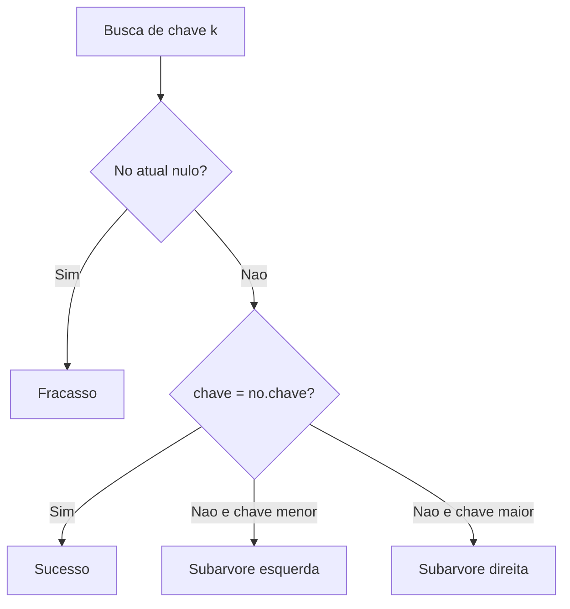

# Árvores de pesquisa e seus algoritmos

## 1. Introdução

Árvores de pesquisa ocupam posição central na organização eficiente de dados ordenáveis. Elas suportam busca, inserção e remoção de forma hierárquica e, quando balanceadas, aproximam-se do limite informacional ótimo para operações de dicionário. A relevância acadêmica dessas estruturas decorre do fato de que elas conectam fundamentos combinatórios, provas de corretude, análise probabilística e engenharia de armazenamento secundário (Cormen et al., 2009; Knuth, 1998).

Além das árvores binárias e árvores binárias de busca, o ecossistema inclui variantes auto-balanceadas como AVL e Red-Black Trees, bem como árvores multiway como B-Trees, fundamentais em sistemas de arquivos e bancos de dados. Cada família materializa um compromisso diferente entre rigidez de balanceamento, custo de atualização, localidade em memória e adequação a hierarquias de armazenamento.

## 2. Fundamentação Teórica

### 2.1 Conceitos básicos

Uma árvore é um grafo conexo e acíclico. Em árvores enraizadas, cada nó possui um pai, exceto a raiz, e zero ou mais filhos. A altura influencia diretamente o custo de operações de pesquisa. Em árvores de busca, a relação de ordem entre chaves permite decidir localmente o próximo ramo a seguir, reduzindo o espaço de busca a cada passo.

### 2.2 Balanceamento

Se a altura de uma árvore binária de busca degenera para $n - 1$, as operações tornam-se lineares. O objetivo de estruturas balanceadas é restringir a altura para $\Theta(\log n)$. AVL faz isso com critério rígido de diferença de alturas. Red-Black Trees empregam coloração e regras menos estritas para reduzir número de rotações. B-Trees redistribuem chaves em páginas com múltiplos filhos, otimizando acesso em disco (Sedgewick, 1998; Cormen et al., 2012).

## 3. Desenvolvimento



### 3.1 Árvores binárias e percursos

Árvores binárias são estruturas hierárquicas nas quais cada nó possui, no máximo, dois filhos, convencionalmente denominados filho esquerdo e filho direito. Essa organização permite representar relações hierárquicas de forma eficiente e serve como base para diversas estruturas mais avançadas, como árvores AVL, Red-Black Trees e heaps.

Os percursos fundamentais em árvores binárias são:

#### Percurso em pré-ordem

O percurso em pré-ordem visita primeiro a raiz da subárvore corrente e depois percorre recursivamente os filhos esquerdo e direito. É frequentemente utilizado para serialização de árvores, cópia de estruturas hierárquicas e representação de expressões prefixadas.

**Pseudocódigo**

```text
algoritmo pre_ordem(no)
    se no = nulo então retorne

    visite(no)
    pre_ordem(no.esq)
    pre_ordem(no.dir)
fim
```

#### Percurso em-ordem

O percurso em-ordem visita a subárvore esquerda antes da raiz e a subárvore direita depois da raiz. Em árvores binárias de busca (BST), esse percurso produz os elementos em ordem crescente, sendo amplamente utilizado para exibição ordenada de dados.

**Pseudocódigo**

```text
algoritmo em_ordem(no)
    se no = nulo então retorne

    em_ordem(no.esq)
    visite(no)
    em_ordem(no.dir)
fim
```

#### Percurso em pós-ordem

O percurso em pós-ordem processa completamente os descendentes antes de visitar a raiz. É amplamente utilizado em operações de remoção de árvores, liberação de memória e avaliação de expressões pós-fixadas.

**Pseudocódigo**

```text
algoritmo pos_ordem(no)
    se no = nulo então retorne

    pos_ordem(no.esq)
    pos_ordem(no.dir)
    visite(no)
fim
```

A implementação das operações básicas de busca, inserção e remoção geralmente utiliza recursão. Em árvores binárias de busca, a propriedade fundamental estabelece que todos os valores da subárvore esquerda são menores que a chave do nó atual e todos os valores da subárvore direita são maiores, permitindo buscas eficientes quando a árvore permanece balanceada.

| Estrutura              | Facilidade de implementação | Facilidade de uso | Desempenho              | Consumo de memória | Vantagens                      | Desvantagens                    | Casos de uso          | Big O típico              |
| ---------------------- | --------------------------- | ----------------- | ----------------------- | ------------------ | ------------------------------ | ------------------------------- | --------------------- | ------------------------- |
| Árvore binária simples | Média                       | Média             | Dependente da forma     | O(n)               | Modela hierarquia naturalmente | Sem garantia de busca eficiente | Expressões, parsing   | Busca O(n)                |
| BST                    | Média                       | Alta              | Muito bom se balanceada | O(n)               | Busca orientada por ordem      | Pode degenerar                  | Dicionários ordenados | Média O(log n), pior O(n) |

#### Algoritmo 1: BST com inserção

**Exemplo de construção de uma BST.** Considere a inserção das chaves:

```text
50, 30, 70, 20, 40, 60, 80
```

A árvore resultante é:

```text
                50
              /    \
            30      70
           /  \    /  \
         20   40  60   80
```

Por exemplo:

* Buscar a chave 60 percorre os nós 50 → 70 → 60.
* Inserir a chave 65 adicionaria um novo nó à direita de 60.
* Remover a chave 70 exigiria a substituição pelo seu sucessor em-ordem (80 ou 60, dependendo da estratégia adotada).

```

**Pseudocódigo**

```text
algoritmo bst_inserir(no, chave)
    se no = nulo então
        retorne novo_no(chave)
    fim

    se chave < no.chave então
        no.esq <- bst_inserir(no.esq, chave)

    senao se chave > no.chave então
        no.dir <- bst_inserir(no.dir, chave)
    fim

    retorne no

fim

algoritmo bst_remover(no, chave)
    se no = nulo então
        retorne nulo
    fim

    se chave < no.chave então
        no.esq <- bst_remover(no.esq, chave)

    senao se chave > no.chave então
        no.dir <- bst_remover(no.dir, chave)

    senao
        se no.esq = nulo então
            temp <- no.dir
            libere(no)
            retorne temp
        fim

        se no.dir = nulo então
            temp <- no.esq
            libere(no)
            retorne temp
        fim

        sucessor <- minimo(no.dir)
        no.chave <- sucessor.chave
        no.dir <- bst_remover(no.dir, sucessor.chave)
    fim

    retorne no
fim

algoritmo bst_buscar(no, chave)
    se no = nulo ou no.chave = chave então
        retorne no
    fim

    se chave < no.chave então
        retorne bst_buscar(no.esq, chave)
    fim

    retorne bst_buscar(no.dir, chave)
fim
```

**Implementação completa em C**

```c
#include <stdio.h>
#include <stdlib.h>

typedef struct NoArvore {
    int chave;
    int altura;
    struct NoArvore *esquerda;
    struct NoArvore *direita;
} NoArvore;

NoArvore *bst_criar_no(int chave) {
    NoArvore *no = (NoArvore *)malloc(sizeof(NoArvore));
    if (no == NULL) {
        return NULL;
    }
    no->chave = chave;
    no->altura = 1;
    no->esquerda = NULL;
    no->direita = NULL;
    return no;
}

NoArvore *bst_buscar(NoArvore *raiz, int chave) {
    if (raiz == NULL || raiz->chave == chave) {
        return raiz;
    }
    if (chave < raiz->chave) {
        return bst_buscar(raiz->esquerda, chave);
    }
    return bst_buscar(raiz->direita, chave);
}

NoArvore *bst_inserir(NoArvore *raiz, int chave) {
    if (raiz == NULL) {
        return bst_criar_no(chave);
    }
    if (chave < raiz->chave) {
        raiz->esquerda = bst_inserir(raiz->esquerda, chave);
    } else if (chave > raiz->chave) {
        raiz->direita = bst_inserir(raiz->direita, chave);
    }
    return raiz;
}

NoArvore *bst_minimo(NoArvore *raiz) {
    while (raiz != NULL && raiz->esquerda != NULL) {
        raiz = raiz->esquerda;
    }
    return raiz;
}

NoArvore *bst_remover(NoArvore *raiz, int chave) {
    if (raiz == NULL) {
        return NULL;
    }

    if (chave < raiz->chave) {
        raiz->esquerda = bst_remover(raiz->esquerda, chave);
    } else if (chave > raiz->chave) {
        raiz->direita = bst_remover(raiz->direita, chave);
    } else {
        if (raiz->esquerda == NULL) {
            NoArvore *temp = raiz->direita;
            free(raiz);
            return temp;
        }
        if (raiz->direita == NULL) {
            NoArvore *temp = raiz->esquerda;
            free(raiz);
            return temp;
        }

        NoArvore *sucessor = bst_minimo(raiz->direita);
        raiz->chave = sucessor->chave;
        raiz->direita = bst_remover(raiz->direita, sucessor->chave);
    }

    return raiz;
}

void bst_inorder(const NoArvore *raiz) {
    if (raiz == NULL) {
        return;
    }
    bst_inorder(raiz->esquerda);
    printf("%d ", raiz->chave);
    bst_inorder(raiz->direita);
}
```

**Complexidade.** Busca, inserção e remoção custam $O(h)$, em que $h$ é a altura. Melhor e médio caso aproximam-se de $O(\log n)$; pior caso $O(n)$. Espaço recursivo também é $O(h)$.

**Explicação das partes relevantes.** A remoção com dois filhos substitui a chave pelo sucessor em-ordem; a busca preserva a propriedade de ordem local; a profundidade recursiva acompanha a altura da árvore.
