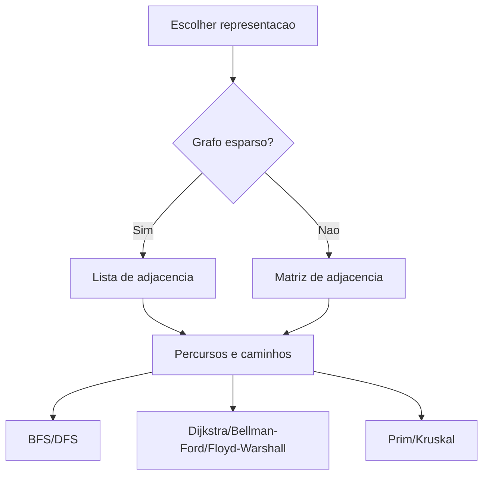

# Grafos e seus algoritmos

## 1. Introdução

Grafos constituem uma das abstrações mais poderosas da ciência da computação para modelar relações entre entidades. Redes de computadores, malhas logísticas, dependências entre tarefas, grafos de chamadas, redes sociais, sistemas biológicos e circuitos são exemplos de domínios naturalmente expressos como vértices e arestas. O estudo de algoritmos em grafos é especialmente relevante porque o mesmo objeto matemático suporta problemas de conectividade, caminhos mínimos, árvores geradoras, ordenação parcial, particionamento e fluxo, cada qual com implicações computacionais distintas (Cormen et al., 2009; Sedgewick, 1997).

## 2. Fundamentação Teórica

Um grafo $G = (V, E)$ é formado por um conjunto de vértices $V$ e um conjunto de arestas $E$. Em grafos direcionados, arestas possuem orientação; em grafos não direcionados, a relação é simétrica. Grafos ponderados associam pesos a arestas, permitindo modelar custo, distância, tempo ou capacidade. A escolha da representação, matriz ou lista de adjacência, afeta fortemente memória e desempenho algorítmico (Cormen et al., 2012).

Busca em largura (BFS) e busca em profundidade (DFS) são algoritmos fundamentais de travessia. A partir deles derivam técnicas para componentes conexos, detecção de ciclos, ordenação topológica e análise estrutural. Para caminhos mínimos, Dijkstra baseia-se na escolha iterativa do vértice com menor distância estimada, assumindo pesos não negativos; Bellman-Ford admite pesos negativos; e Floyd-Warshall calcula as menores distâncias entre todos os pares de vértices por meio de programação dinâmica. Para árvores geradoras mínimas, Prim expande gradualmente um único componente conectado escolhendo a aresta de menor custo incidente à árvore corrente, enquanto Kruskal constrói a solução pela união sucessiva de componentes por meio das arestas de menor peso (Cormen et al., 2009; Ziviani, 2004).

Existem vários tipos de grafos, como ponderados, não ponderados, direcionados, não direcionados, cíclicos, acíclicos, conexos, desconexos, esparsos e densos. Grafos ponderados atribuem um valor numérico a cada aresta, representando custo, distância ou capacidade. Grafos não ponderados tratam todas as arestas como equivalentes. Grafos direcionados possuem arestas com orientação específica, enquanto grafos não direcionados têm arestas simétricas. Grafos cíclicos contêm pelo menos um ciclo, enquanto grafos acíclicos não possuem ciclos. Grafos conexos têm um caminho entre qualquer par de vértices, enquanto grafos desconexos possuem pelo menos um par de vértices sem caminho entre eles. Grafos esparsos têm relativamente poucas arestas em comparação com o número de vértices, enquanto grafos densos têm um número de arestas próximo ao máximo possível (Cormen et al., 2012).

## 3. Desenvolvimento

No diagrama a seguir, apresenta-se um guia de decisão para escolher a representação e os algoritmos adequados para diferentes tipos de grafos e problemas:


### 3.1 Representação de grafos

Matriz de adjacência é uma tabela $V \times V$ onde a entrada $(i, j)$ indica a presença e peso da aresta entre os vértices $i$ e $j$. É eficiente para grafos densos, mas consome $O(V^2)$ memória. Lista de adjacência armazena, para cada vértice, uma lista de seus vizinhos e pesos, sendo mais econômica para grafos esparsos, com custo de $O(V + E)$.

| Representação        | Facilidade de implementação | Facilidade de uso | Desempenho                        | Consumo de memória | Vantagens                    | Desvantagens                               | Casos de uso                  | Big O principal         |
| -------------------- | --------------------------- | ----------------- | --------------------------------- | ------------------ | ---------------------------- | ------------------------------------------ | ----------------------------- | ----------------------- |
| Matriz de adjacência | Alta                        | Alta              | Excelente para consulta de aresta | O(V^2)             | Simples e direta             | Ruim para grafos esparsos                  | Floyd-Warshall, grafos densos | Consulta O(1)           |
| Lista de adjacência  | Média                       | Alta              | Excelente para iterar vizinhos    | O(V + E)           | Econômica em grafos esparsos | Consulta de aresta pode ser linear no grau | BFS, DFS, Dijkstra com heap   | Iterar vizinhos O(grau) |

**Implementação base em C**

```c
#define MAXV 8
#define INFINITO 1000000000

typedef struct {
    int vertices;
    int matriz[MAXV][MAXV];
} GrafoMatriz;

typedef struct {
    int origem;
    int destino;
    int peso;
} Aresta;
```

### 3.2 BFS e DFS

#### Algoritmo 1: BFS

**Explicação teórica.** BFS explora camadas de distância crescente a partir da origem. Em grafos não ponderados, ela calcula distâncias mínimas em número de arestas.

**Pseudocódigo**

```text
algoritmo bfs(G, origem)
    inicialize fila
    marque origem visitada
    enquanto fila nao vazia faca
        remova vertice u
        para cada vizinho v de u faca
            se v nao visitado entao
                marque visitado e enfileire v
fim
```

**Implementação completa em C**

```c
#include <stdio.h>

void bfs(const GrafoMatriz *grafo, int origem) {
    int visitado[MAXV] = {0};
    int fila[MAXV];
    int inicio = 0;
    int fim = 0;

    visitado[origem] = 1;
    fila[fim++] = origem;

    while (inicio < fim) {
        int u = fila[inicio++];
        printf("%d ", u);

        for (int v = 0; v < grafo->vertices; v++) {
            if (grafo->matriz[u][v] != 0 && !visitado[v]) {
                visitado[v] = 1;
                fila[fim++] = v;
            }
        }
    }
}
```

**Complexidade.** Em matriz, $O(V^2)$; em lista de adjacência, $O(V + E)$. Espaço adicional $O(V)$.

**Partes importantes.** A fila garante travessia por níveis; a marcação antecipada evita múltiplas inserções do mesmo vértice.

#### Algoritmo 2: DFS

**Explicação teórica.** DFS aprofunda o caminho atual antes de retroceder. É útil para explorar componentes, detectar ciclos e realizar ordenação topológica.

**Pseudocódigo**

```text
algoritmo dfs(G, origem)
    marque origem visitada
    para cada vizinho v de origem faca
        se v nao visitado entao
            dfs(G, v)
fim
```

**Implementação completa em C**

```c
void dfs_visit(const GrafoMatriz *grafo, int u, int visitado[]) {
    visitado[u] = 1;
    printf("%d ", u);

    for (int v = 0; v < grafo->vertices; v++) {
        if (grafo->matriz[u][v] != 0 && !visitado[v]) {
            dfs_visit(grafo, v, visitado);
        }
    }
}

void dfs(const GrafoMatriz *grafo, int origem) {
    int visitado[MAXV] = {0};
    dfs_visit(grafo, origem, visitado);
}
```

**Complexidade.** Igual à BFS para a representação adotada.

**Comparação.** BFS é preferível para distâncias mínimas em grafos não ponderados; DFS é mais comum para análise estrutural e exploração de caminhos.

### 3.3 Caminhos mínimos

#### Algoritmo 3: Dijkstra

**Explicação teórica.** Dijkstra aplica busca gulosa escolhendo iterativamente o vértice não processado com menor distância temporária. Exige pesos não negativos.

**Pseudocódigo**

```text
algoritmo dijkstra(G, origem)
    dist <- infinito
    dist[origem] <- 0
    repita V vezes
        u <- vertice não visitado com menor dist
        visitado[u] <- verdadeiro
        para cada vizinho v de u faça
            se visitado[v] = falso então
                nova_dist <- dist[u] + peso(u,v)
                se nova_dist < dist[v] então
                    dist[v] <- nova_dist
                fim
fim
```

**Implementação completa em C**

```c
int extrair_minimo(int dist[], int processado[], int vertices) {
    int melhor = INFINITO;
    int indice = -1;

    for (int i = 0; i < vertices; i++) {
        if (!processado[i] && dist[i] < melhor) {
            melhor = dist[i];
            indice = i;
        }
    }

    return indice;
}

void dijkstra(const GrafoMatriz *grafo, int origem, int dist[]) {
    int processado[MAXV] = {0};

    for (int i = 0; i < grafo->vertices; i++) {
        dist[i] = INFINITO;
    }
    dist[origem] = 0;

    for (int i = 0; i < grafo->vertices; i++) {
        int u = extrair_minimo(dist, processado, grafo->vertices);
        if (u == -1) {
            break;
        }
        processado[u] = 1;

        for (int v = 0; v < grafo->vertices; v++) {
            int peso = grafo->matriz[u][v];
            if (peso > 0 && !processado[v] && dist[u] + peso < dist[v]) {
                dist[v] = dist[u] + peso;
            }
        }
    }
}
```

**Complexidade.** Em matriz, $O(V^2)$; com heap binário e lista de adjacência, $O((V + E) \log V)$.

**Limitação.** Não admite arestas negativas, pois pode levar a ciclos de redução infinita.

#### Algoritmo 4: Bellman-Ford

**Explicação teórica.** Bellman-Ford percorre todas as arestas por $V - 1$ iterações, atualizando sucessivamente as estimativas de distância entre os vértices, garantindo caminhos mínimos mesmo com pesos negativos, desde que não haja ciclo negativo alcançável.

**Pseudocódigo**

```text
algoritmo bellman_ford(G, origem)
    dist <- infinito
    dist[origem] <- 0
    para i de 1 a V-1 faça
        para cada aresta (u, v) com peso w faça
            se dist[u] + w < dist[v] então
                dist[v] <- dist[u] + w
            fim
    para cada aresta (u, v) com peso w faça
        se dist[u] + w < dist[v] então
            retorne "Ciclo negativo detectado"
    retorne dist
```

**Implementação completa em C**

```c
int bellman_ford(int vertices, int arestas, const Aresta lista_arestas[], int origem, int dist[]) {
    for (int i = 0; i < vertices; i++) {
        dist[i] = INFINITO;
    }
    dist[origem] = 0;

    for (int i = 1; i < vertices; i++) {
        for (int j = 0; j < arestas; j++) {
            int u = lista_arestas[j].origem;
            int v = lista_arestas[j].destino;
            int peso = lista_arestas[j].peso;
            if (dist[u] != INFINITO && dist[u] + peso < dist[v]) {
                dist[v] = dist[u] + peso;
            }
        }
    }

    for (int j = 0; j < arestas; j++) {
        int u = lista_arestas[j].origem;
        int v = lista_arestas[j].destino;
        int peso = lista_arestas[j].peso;
        if (dist[u] != INFINITO && dist[u] + peso < dist[v]) {
            return 0;
        }
    }

    return 1;
}
```

**Complexidade.** Tempo $O(VE)$; espaço $O(V)$.

#### Algoritmo 5: Floyd-Warshall

**Explicação teórica.** Floyd-Warshall resolve o problema de todos os pares via programação dinâmica, refinando gradualmente o conjunto de vértices intermediários permitidos.

**Pseudocódigo**

```text
algoritmo floyd_warshall(G)
    para k de 1 a V faça
        para i de 1 a V faça
            para j de 1 a V faça
                se dist[i][k] + dist[k][j] < dist[i][j] então
                    dist[i][j] <- dist[i][k] + dist[k][j]
fim
```

**Implementação completa em C**

```c
void floyd_warshall(int vertices, int dist[MAXV][MAXV]) {
    for (int k = 0; k < vertices; k++) {
        for (int i = 0; i < vertices; i++) {
            for (int j = 0; j < vertices; j++) {
                if (dist[i][k] < INFINITO && dist[k][j] < INFINITO &&
                    dist[i][k] + dist[k][j] < dist[i][j]) {
                    dist[i][j] = dist[i][k] + dist[k][j];
                }
            }
        }
    }
}
```

**Complexidade.** Tempo $O(V^3)$; espaço $O(V^2)$.

### 3.4 Árvores geradoras mínimas

#### Algoritmo 6: Prim

**Explicação teórica.** Prim cresce uma árvore a partir de um vértice inicial, sempre escolhendo a aresta de menor custo que conecta a árvore atual a um novo vértice.

**Pseudocódigo**

```text
algoritmo prim(G, origem)
    chave <- infinito para todos os vertices
    pai <- -1 para todos os vertices
    chave[origem] <- 0
    incluido <- falso para todos os vertices

    para i de 1 a V-1 faca
        u <- vertice nao incluido com menor chave
        incluido[u] <- verdadeiro
        para cada vizinho v de u faca
            se !incluido[v] e peso(u,v) < chave[v] entao
                pai[v] <- u
                chave[v] <- peso(u,v)
fim
```

**Implementação completa em C**

```c
int minimo_chave(int chave[], int incluido[], int vertices) {
    int melhor = INFINITO;
    int indice = -1;
    for (int v = 0; v < vertices; v++) {
        if (!incluido[v] && chave[v] < melhor) {
            melhor = chave[v];
            indice = v;
        }
    }
    return indice;
}

void prim(const GrafoMatriz *grafo, int pai[]) {
    int chave[MAXV];
    int incluido[MAXV] = {0};

    for (int i = 0; i < grafo->vertices; i++) {
        chave[i] = INFINITO;
        pai[i] = -1;
    }

    chave[0] = 0;
    for (int i = 0; i < grafo->vertices - 1; i++) {
        int u = minimo_chave(chave, incluido, grafo->vertices);
        incluido[u] = 1;
        for (int v = 0; v < grafo->vertices; v++) {
            int peso = grafo->matriz[u][v];
            if (peso > 0 && !incluido[v] && peso < chave[v]) {
                pai[v] = u;
                chave[v] = peso;
            }
        }
    }
}
```

**Complexidade.** Em matriz, $O(V^2)$; com heap, $O(E \log V)$.

#### Algoritmo 7: Kruskal

**Explicação teórica.** Kruskal ordena arestas por peso e adiciona cada uma se ela conectar componentes distintos, usando união-busca para evitar ciclos.

**Pseudocódigo**

```text
algoritmo kruskal(G)
    ordene arestas por peso
    para cada aresta (u, v) em ordem crescente faca
        se uf_encontrar(u) != uf_encontrar(v) entao
            uf_unir(u, v)
fim

algoritmo uf_encontrar(pai, x)
    se pai[x] != x entao
        pai[x] <- uf_encontrar(pai, pai[x])
    retorne pai[x]

algoritmo uf_unir(pai, rank, a, b)
    a <- uf_encontrar(a)
    b <- uf_encontrar(b)
    se a == b entao
        retorne
    se rank[a] < rank[b] entao
        pai[a] <- b
    senao se rank[a] > rank[b] entao
        pai[b] <- a
    senao
        pai[b] <- a
        rank[a]++
```

**Implementação completa em C**

```c
int uf_encontrar(int pai[], int x) {
    if (pai[x] != x) {
        pai[x] = uf_encontrar(pai, pai[x]);
    }
    return pai[x];
}

void uf_unir(int pai[], int rank[], int a, int b) {
    a = uf_encontrar(pai, a);
    b = uf_encontrar(pai, b);

    if (a == b) {
        return;
    }
    if (rank[a] < rank[b]) {
        pai[a] = b;
    } else if (rank[a] > rank[b]) {
        pai[b] = a;
    } else {
        pai[b] = a;
        rank[a]++;
    }
}
```

**Complexidade.** Ordenação das arestas domina o custo: $O(E \log E)$, com operações quase constantes amortizadas na estrutura union-find.

### 3.5 Ordenação topológica e componentes conexos

#### Algoritmo 8: ordenação topológica por Kahn

Ordenação topológica é possível apenas em DAGs. Kahn constrói a ordenação removendo iterativamente vértices de grau de entrada zero.

**Implementação completa em C**

```c
int ordenacao_topologica(const GrafoMatriz *grafo, int ordem[]) {
    int grau_entrada[MAXV] = {0};
    int fila[MAXV];
    int inicio = 0;
    int fim = 0;
    int quantidade = 0;

    for (int u = 0; u < grafo->vertices; u++) {
        for (int v = 0; v < grafo->vertices; v++) {
            if (grafo->matriz[u][v] != 0) {
                grau_entrada[v]++;
            }
        }
    }

    for (int i = 0; i < grafo->vertices; i++) {
        if (grau_entrada[i] == 0) {
            fila[fim++] = i;
        }
    }

    while (inicio < fim) {
        int u = fila[inicio++];
        ordem[quantidade++] = u;
        for (int v = 0; v < grafo->vertices; v++) {
            if (grafo->matriz[u][v] != 0) {
                grau_entrada[v]--;
                if (grau_entrada[v] == 0) {
                    fila[fim++] = v;
                }
            }
        }
    }

    return quantidade == grafo->vertices;
}
```

**Complexidade.** Em matriz, $O(V^2)$; em lista, $O(V + E)$.

#### Algoritmo 9: componentes conexos

**Implementação completa em C**

```c
int componentes_conexos(const GrafoMatriz *grafo) {
    int visitado[MAXV] = {0};
    int componentes = 0;

    for (int v = 0; v < grafo->vertices; v++) {
        if (!visitado[v]) {
            dfs_visit(grafo, v, visitado);
            componentes++;
        }
    }

    return componentes;
}
```

**Complexidade.** Igual à DFS base, pois cada vértice é iniciado no máximo uma vez.

## 4. Exemplos, Aplicações e Estudos de Caso

BFS é usado em roteamento sem pesos, análise de distância social e expansão por níveis em jogos. DFS é central em compiladores, análise de dependências e mineração de componentes. Dijkstra sustenta GPS e roteamento em redes com pesos não negativos. Bellman-Ford aparece em protocolos que precisam detectar custos negativos ou atualizações iterativas. Floyd-Warshall é útil em fechamento transitivo e análise de todos os pares em grafos densos. Prim e Kruskal modelam expansão de redes elétricas, ópticas e viárias. Ordenação topológica resolve planejamento com pré-requisitos. Componentes conexos apoiam análise de comunidades e segmentação estrutural.

Um estudo de caso real é o planejamento de distribuição urbana: o grafo da malha viária pode ser percorrido por BFS para alcance, por Dijkstra para rotas mínimas, por Prim para expansão de infraestrutura e por componentes conexos para detectar regiões isoladas após falhas.

## 5. Comparações e Análises

| Algoritmo      | Facilidade de implementação | Facilidade de uso | Desempenho             | Consumo de memória | Vantagens                                   | Desvantagens                  | Casos de uso            | Big O                  |
| -------------- | --------------------------- | ----------------- | ---------------------- | ------------------ | ------------------------------------------- | ----------------------------- | ----------------------- | ---------------------- |
| BFS            | Alta                        | Alta              | Excelente              | O(V)               | Menores distâncias em grafos não ponderados | Não usa pesos                 | Alcance e camadas       | O(V + E)               |
| DFS            | Alta                        | Alta              | Excelente              | O(V)               | Estruturalmente versátil                    | Não minimiza distâncias       | Ciclos e componentes    | O(V + E)               |
| Dijkstra       | Média                       | Alta              | Muito bom              | O(V) a O(V + E)    | Eficiente com pesos não negativos           | Falha com pesos negativos     | Roteamento              | O(V^2) ou O((V+E)logV) |
| Bellman-Ford   | Média                       | Média             | Mais lento             | O(V)               | Tolera pesos negativos                      | Custo alto                    | Protocolos distribuídos | O(VE)                  |
| Floyd-Warshall | Alta                        | Alta              | Bom para grafos densos | O(V^2)             | Todos os pares                              | Muito caro em grafos grandes  | Análise global          | O(V^3)                 |
| Prim           | Média                       | Alta              | Excelente              | O(V)               | MST incremental                             | Depende de estrutura auxiliar | Redes físicas           | O(V^2) ou O(ElogV)     |
| Kruskal        | Média                       | Alta              | Excelente              | O(V)               | Simples com union-find                      | Requer ordenação              | Grafos esparsos         | O(ElogE)               |
| Topológica     | Média                       | Alta              | Excelente              | O(V)               | Resolve dependências                        | Só para DAGs                  | Build e escalonamento   | O(V + E)               |
| Componentes    | Alta                        | Alta              | Excelente              | O(V)               | Diagnóstico estrutural                      | Não resolve pesos             | Segmentação             | O(V + E)               |

Armadilhas frequentes incluem ignorar direção das arestas, misturar representações com semânticas distintas, aplicar Dijkstra a pesos negativos, esquecer de inicializar infinito e negligenciar conectividade ao usar algoritmos de MST. A otimização prática costuma depender mais da representação e do uso de estruturas auxiliares eficientes do que do pseudocódigo básico isolado.
