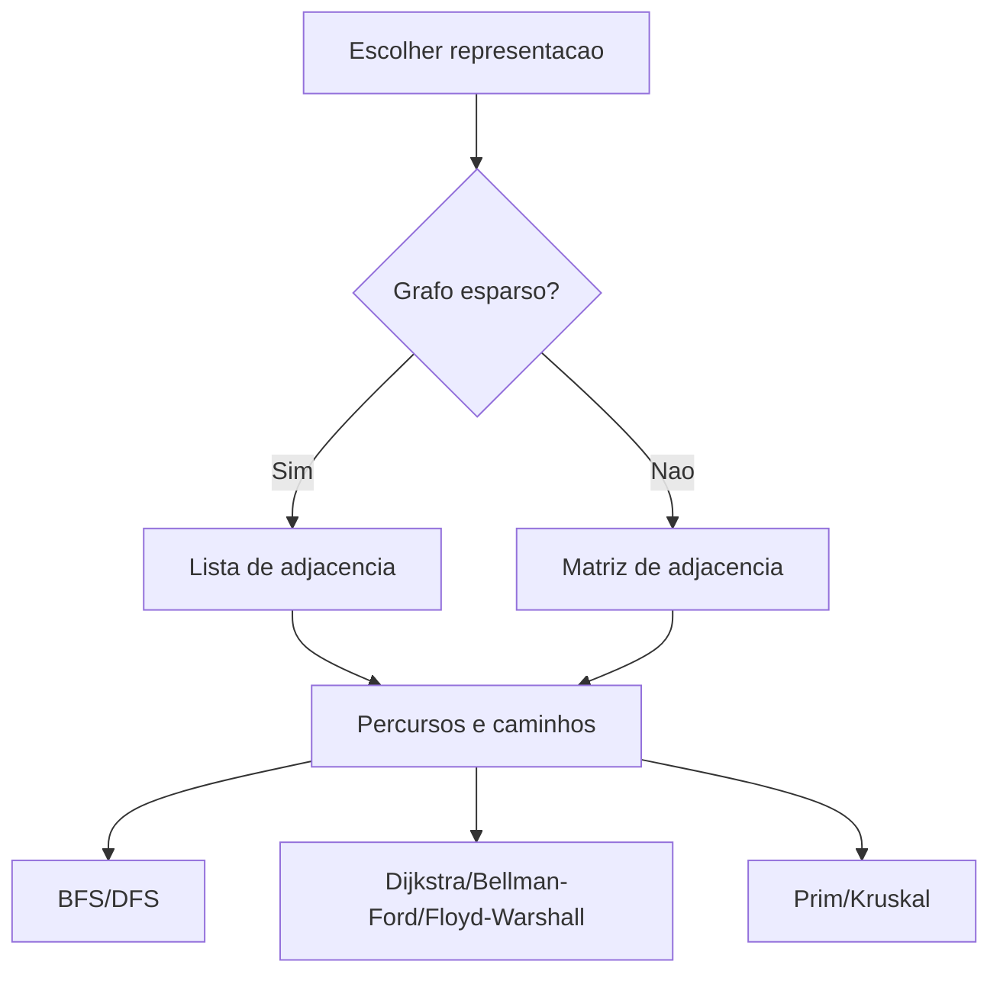

# Grafos e seus algoritmos

## 1. Introdução

Grafos constituem uma das abstrações mais poderosas da ciência da computação para modelar relações entre entidades. Redes de computadores, malhas logísticas, dependências entre tarefas, grafos de chamadas, redes sociais, sistemas biológicos e circuitos são exemplos de domínios naturalmente expressos como vértices e arestas. O estudo de algoritmos em grafos é especialmente relevante porque o mesmo objeto matemático suporta problemas de conectividade, caminhos mínimos, árvores geradoras, ordenação parcial, particionamento e fluxo, cada qual com implicações computacionais distintas (Cormen et al., 2009; Sedgewick, 1997).

## 2. Fundamentação Teórica

Um grafo $G = (V, E)$ é formado por um conjunto de vértices $V$ e um conjunto de arestas $E$. Em grafos direcionados, arestas possuem orientação; em grafos não direcionados, a relação é simétrica. Grafos ponderados associam pesos a arestas, permitindo modelar custo, distância, tempo ou capacidade. A escolha da representação, matriz ou lista de adjacência, afeta fortemente memória e desempenho algorítmico (Cormen et al., 2012).

Busca em largura (BFS) e busca em profundidade (DFS) são algoritmos fundamentais de travessia. A partir deles derivam técnicas para componentes conexos, detecção de ciclos, ordenação topológica e análise estrutural. Para caminhos mínimos, Dijkstra baseia-se na escolha iterativa do vértice com menor distância estimada, assumindo pesos não negativos; Bellman-Ford admite pesos negativos; e Floyd-Warshall calcula as menores distâncias entre todos os pares de vértices por meio de programação dinâmica. Para árvores geradoras mínimas, Prim expande gradualmente um único componente conectado escolhendo a aresta de menor custo incidente à árvore corrente, enquanto Kruskal constrói a solução pela união sucessiva de componentes por meio das arestas de menor peso (Cormen et al., 2009; Ziviani, 2004).

Existem vários tipos de grafos, como ponderados, não ponderados, direcionados, não direcionados, cíclicos, acíclicos, conexos, desconexos, esparsos e densos. Grafos ponderados atribuem um valor numérico a cada aresta, representando custo, distância ou capacidade. Grafos não ponderados tratam todas as arestas como equivalentes. Grafos direcionados possuem arestas com orientação específica, enquanto grafos não direcionados têm arestas simétricas. Grafos cíclicos contêm pelo menos um ciclo, enquanto grafos acíclicos não possuem ciclos. Grafos conexos têm um caminho entre qualquer par de vértices, enquanto grafos desconexos possuem pelo menos um par de vértices sem caminho entre eles. Grafos esparsos têm relativamente poucas arestas em comparação com o número de vértices, enquanto grafos densos têm um número de arestas próximo ao máximo possível (Cormen et al., 2012).

## 3. Desenvolvimento

No diagrama a seguir, apresenta-se um guia de decisão para escolher a representação e os algoritmos adequados para diferentes tipos de grafos e problemas:


### 3.1 Representação de grafos

Matriz de adjacência é uma tabela $V \times V$ onde a entrada $(i, j)$ indica a presença e peso da aresta entre os vértices $i$ e $j$. É eficiente para grafos densos, mas consome $O(V^2)$ memória. Lista de adjacência armazena, para cada vértice, uma lista de seus vizinhos e pesos, sendo mais econômica para grafos esparsos, com custo de $O(V + E)$.

| Representação        | Facilidade de implementação | Facilidade de uso | Desempenho                        | Consumo de memória | Vantagens                    | Desvantagens                               | Casos de uso                  | Big O principal         |
| -------------------- | --------------------------- | ----------------- | --------------------------------- | ------------------ | ---------------------------- | ------------------------------------------ | ----------------------------- | ----------------------- |
| Matriz de adjacência | Alta                        | Alta              | Excelente para consulta de aresta | O(V^2)             | Simples e direta             | Ruim para grafos esparsos                  | Floyd-Warshall, grafos densos | Consulta O(1)           |
| Lista de adjacência  | Média                       | Alta              | Excelente para iterar vizinhos    | O(V + E)           | Econômica em grafos esparsos | Consulta de aresta pode ser linear no grau | BFS, DFS, Dijkstra com heap   | Iterar vizinhos O(grau) |

**Implementação base em C**

```c
#define MAXV 8
#define INFINITO 1000000000

typedef struct {
    int vertices;
    int matriz[MAXV][MAXV];
} GrafoMatriz;

typedef struct {
    int origem;
    int destino;
    int peso;
} Aresta;
```

### 3.2 BFS e DFS

#### Algoritmo 1: BFS

**Explicação teórica.** BFS explora camadas de distância crescente a partir da origem. Em grafos não ponderados, ela calcula distâncias mínimas em número de arestas.

**Pseudocódigo**

```text
algoritmo bfs(G, origem)
    inicialize fila
    marque origem visitada
    enquanto fila nao vazia faca
        remova vertice u
        para cada vizinho v de u faca
            se v nao visitado entao
                marque visitado e enfileire v
fim
```

**Implementação completa em C**

```c
#include <stdio.h>

void bfs(const GrafoMatriz *grafo, int origem) {
    int visitado[MAXV] = {0};
    int fila[MAXV];
    int inicio = 0;
    int fim = 0;

    visitado[origem] = 1;
    fila[fim++] = origem;

    while (inicio < fim) {
        int u = fila[inicio++];
        printf("%d ", u);

        for (int v = 0; v < grafo->vertices; v++) {
            if (grafo->matriz[u][v] != 0 && !visitado[v]) {
                visitado[v] = 1;
                fila[fim++] = v;
            }
        }
    }
}
```

**Complexidade.** Em matriz, $O(V^2)$; em lista de adjacência, $O(V + E)$. Espaço adicional $O(V)$.

**Partes importantes.** A fila garante travessia por níveis; a marcação antecipada evita múltiplas inserções do mesmo vértice.

#### Algoritmo 2: DFS

**Explicação teórica.** DFS aprofunda o caminho atual antes de retroceder. É útil para explorar componentes, detectar ciclos e realizar ordenação topológica.

**Pseudocódigo**

```text
algoritmo dfs(G, origem)
    marque origem visitada
    para cada vizinho v de origem faca
        se v nao visitado entao
            dfs(G, v)
fim
```

**Implementação completa em C**

```c
void dfs_visit(const GrafoMatriz *grafo, int u, int visitado[]) {
    visitado[u] = 1;
    printf("%d ", u);

    for (int v = 0; v < grafo->vertices; v++) {
        if (grafo->matriz[u][v] != 0 && !visitado[v]) {
            dfs_visit(grafo, v, visitado);
        }
    }
}

void dfs(const GrafoMatriz *grafo, int origem) {
    int visitado[MAXV] = {0};
    dfs_visit(grafo, origem, visitado);
}
```

**Complexidade.** Igual à BFS para a representação adotada.

**Comparação.** BFS é preferível para distâncias mínimas em grafos não ponderados; DFS é mais comum para análise estrutural e exploração de caminhos.
