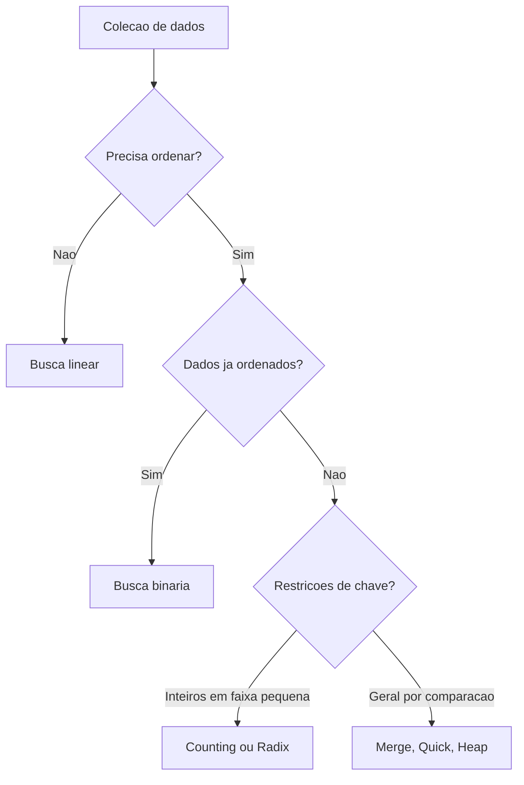

# Algoritmos de busca e ordenação

## 1. Introdução

Busca e ordenação compõem o núcleo clássico da análise de algoritmos. Quase todo sistema computacional, direta ou indiretamente, depende de localizar registros, manter coleções ordenadas, mesclar conjuntos ou reorganizar dados para acelerar consultas. A história da área é marcada precisamente por avanços nesse domínio, desde métodos quadráticos elementares até estratégias assintoticamente sofisticadas e sensíveis à arquitetura de memória (Knuth, 1998; Cormen et al., 2009).

## 2. Fundamentação Teórica

O problema de busca consiste em determinar a presença e, em geral, a posição de uma chave em uma coleção. O problema de ordenação consiste em permutar os elementos de uma sequência segundo uma relação de ordem. Esses problemas estão intimamente ligados: uma vez ordenados, os dados admitem buscas sublineares como busca binária. Em contrapartida, ordenar pode custar mais do que sucessivas buscas lineares quando o volume de consultas é pequeno.

Estabilidade, adaptatividade, uso de memória extra e comportamento em melhor, médio e pior caso são atributos decisivos. Algoritmos estáveis preservam a ordem relativa de chaves iguais. Algoritmos in-place usam memória adicional assintoticamente constante ou muito pequena. Métodos por comparação obedecem ao limite inferior $\Omega(n \log n)$ no pior caso médio, enquanto abordagens como Counting Sort e Radix Sort exploram propriedades das chaves para superar esse limite em contextos específicos (Cormen et al., 2012).

## 3. Desenvolvimento



### 3.1 Algoritmos de busca

| Algoritmo     | Facilidade de implementação | Facilidade de uso | Desempenho               | Consumo de memória                 | Vantagens          | Desvantagens       | Casos de uso                       | Big O                      |
| ------------- | --------------------------- | ----------------- | ------------------------ | ---------------------------------- | ------------------ | ------------------ | ---------------------------------- | -------------------------- |
| Busca linear  | Alta                        | Alta              | Fraco em grandes vetores | O(1)                               | Dispensa ordenação | Escala linearmente | Coleções pequenas ou não ordenadas | Melhor O(1), pior O(n)     |
| Busca binária | Alta                        | Alta              | Excelente                | O(1) iterativa, O(log n) recursiva | Muito eficiente    | Exige ordenação    | Índices e consultas repetidas      | Melhor O(1), pior O(log n) |

#### Algoritmo 1: busca linear

**Pseudocódigo**

```text
algoritmo busca_linear(vetor, n, chave)
    para i de 0 ate n - 1 faca
        se vetor[i] = chave entao retorne i
    retorne -1
fim
```

**Implementação completa em C**

```c
int busca_linear(const int vetor[], int tamanho, int chave) {
    for (int indice = 0; indice < tamanho; indice++) {
        if (vetor[indice] == chave) {
            return indice;
        }
    }
    return -1;
}
```

**Complexidade.** Melhor caso $O(1)$, médio e pior caso $O(n)$, espaço $O(1)$.

**Explicação relevante.** O laço é interrompido no primeiro sucesso, o que torna o custo médio dependente da distribuição das consultas.

**Entrada e saída.** Vetor `{9, 4, 7, 2}`, chave `7`, saída `2`.

**Comparação.** Superior à busca binária apenas quando não se justifica ordenar ou manter estrutura ordenada.

#### Algoritmo 2: busca binária iterativa

**Pseudocódigo**

```text
algoritmo busca_binaria(vetor, n, chave)
    inicio <- 0
    fim <- n - 1
    enquanto inicio <= fim faca
        meio <- inicio + (fim - inicio) / 2
        se vetor[meio] = chave entao retorne meio
        se chave < vetor[meio] entao fim <- meio - 1
        senao inicio <- meio + 1
    retorne -1
fim
```

**Implementação completa em C**

```c
int busca_binaria(const int vetor[], int tamanho, int chave) {
    int inicio = 0;
    int fim = tamanho - 1;

    while (inicio <= fim) {
        int meio = inicio + (fim - inicio) / 2;
        if (vetor[meio] == chave) {
            return meio;
        }
        if (chave < vetor[meio]) {
            fim = meio - 1;
        } else {
            inicio = meio + 1;
        }
    }
    return -1;
}
```

**Complexidade.** Melhor caso $O(1)$, médio e pior $O(\log n)$, espaço $O(1)$.

**Partes importantes.** O cálculo de `meio` evita overflow potencial; a pré-condição de ordenação é indispensável.

### 3.2 Algoritmos simples de ordenação

#### Algoritmo 3: Bubble Sort

**Explicação teórica.** Repetidas trocas adjacentes movem gradualmente maiores elementos para o final. É estável e simples, porém ineficiente.

**Implementação completa em C**

```c
void bubble_sort(int vetor[], int tamanho) {
    for (int i = 0; i < tamanho - 1; i++) {
        int houve_troca = 0;
        for (int j = 0; j < tamanho - 1 - i; j++) {
            if (vetor[j] > vetor[j + 1]) {
                int temp = vetor[j];
                vetor[j] = vetor[j + 1];
                vetor[j + 1] = temp;
                houve_troca = 1;
            }
        }
        if (!houve_troca) {
            break;
        }
    }
}
```

**Complexidade.** Melhor caso $O(n)$ com otimização, médio e pior $O(n^2)$, espaço $O(1)$.

#### Algoritmo 4: Selection Sort

**Implementação completa em C**

```c
void selection_sort(int vetor[], int tamanho) {
    for (int i = 0; i < tamanho - 1; i++) {
        int minimo = i;
        for (int j = i + 1; j < tamanho; j++) {
            if (vetor[j] < vetor[minimo]) {
                minimo = j;
            }
        }
        int temp = vetor[i];
        vetor[i] = vetor[minimo];
        vetor[minimo] = temp;
    }
}
```

**Complexidade.** Melhor, médio e pior caso $O(n^2)$; espaço $O(1)$; não é estável na forma clássica.

#### Algoritmo 5: Insertion Sort

**Explicação teórica.** Mantém um prefixo ordenado e insere cada novo elemento em sua posição correta. É estável e adaptativo.

**Implementação completa em C**

```c
void insertion_sort(int vetor[], int tamanho) {
    for (int i = 1; i < tamanho; i++) {
        int chave = vetor[i];
        int j = i - 1;
        while (j >= 0 && vetor[j] > chave) {
            vetor[j + 1] = vetor[j];
            j--;
        }
        vetor[j + 1] = chave;
    }
}
```

**Complexidade.** Melhor caso $O(n)$, médio e pior $O(n^2)$; espaço $O(1)$.

**Comparação dos métodos simples.** Bubble realiza muitas trocas; Selection minimiza trocas, mas não comparações; Insertion é o mais competitivo em vetores pequenos ou quase ordenados.

### 3.3 Algoritmos eficientes por comparação

#### Algoritmo 6: Merge Sort

**Pseudocódigo**

```text
algoritmo merge_sort(v, l, r)
    se l >= r entao retorne
    m <- (l + r) / 2
    merge_sort(v, l, m)
    merge_sort(v, m + 1, r)
    intercale(v, l, m, r)
fim
```

**Implementação completa em C**

```c
void merge(int vetor[], int esquerda, int meio, int direita) {
    int n1 = meio - esquerda + 1;
    int n2 = direita - meio;
    int esquerda_temp[128];
    int direita_temp[128];

    for (int i = 0; i < n1; i++) esquerda_temp[i] = vetor[esquerda + i];
    for (int j = 0; j < n2; j++) direita_temp[j] = vetor[meio + 1 + j];

    int i = 0, j = 0, k = esquerda;
    while (i < n1 && j < n2) {
        if (esquerda_temp[i] <= direita_temp[j]) {
            vetor[k++] = esquerda_temp[i++];
        } else {
            vetor[k++] = direita_temp[j++];
        }
    }
    while (i < n1) vetor[k++] = esquerda_temp[i++];
    while (j < n2) vetor[k++] = direita_temp[j++];
}

void merge_sort(int vetor[], int esquerda, int direita) {
    if (esquerda >= direita) {
        return;
    }
    int meio = esquerda + (direita - esquerda) / 2;
    merge_sort(vetor, esquerda, meio);
    merge_sort(vetor, meio + 1, direita);
    merge(vetor, esquerda, meio, direita);
}
```

**Complexidade.** Melhor, médio e pior $O(n \log n)$; espaço extra $O(n)$; estável; profundidade recursiva $O(\log n)$.

#### Algoritmo 7: Quick Sort

**Explicação teórica.** Quick Sort particiona o vetor em torno de um pivô. É tipicamente muito rápido na prática, embora tenha pior caso quadrático sem cuidados de pivoteamento.

**Implementação completa em C**

```c
int particionar(int vetor[], int baixo, int alto) {
    int pivo = vetor[alto];
    int i = baixo - 1;
    for (int j = baixo; j < alto; j++) {
        if (vetor[j] <= pivo) {
            i++;
            int temp = vetor[i];
            vetor[i] = vetor[j];
            vetor[j] = temp;
        }
    }
    int temp = vetor[i + 1];
    vetor[i + 1] = vetor[alto];
    vetor[alto] = temp;
    return i + 1;
}

void quick_sort(int vetor[], int baixo, int alto) {
    if (baixo < alto) {
        int p = particionar(vetor, baixo, alto);
        quick_sort(vetor, baixo, p - 1);
        quick_sort(vetor, p + 1, alto);
    }
}
```

**Complexidade.** Melhor e médio $O(n \log n)$; pior $O(n^2)$; espaço de pilha médio $O(\log n)$ e pior $O(n)$; não é estável; in-place.

#### Algoritmo 8: Heap Sort

**Implementação completa em C**

```c
void heapify(int vetor[], int tamanho, int raiz) {
    int maior = raiz;
    int esquerda = 2 * raiz + 1;
    int direita = 2 * raiz + 2;

    if (esquerda < tamanho && vetor[esquerda] > vetor[maior]) maior = esquerda;
    if (direita < tamanho && vetor[direita] > vetor[maior]) maior = direita;

    if (maior != raiz) {
        int temp = vetor[raiz];
        vetor[raiz] = vetor[maior];
        vetor[maior] = temp;
        heapify(vetor, tamanho, maior);
    }
}

void heap_sort(int vetor[], int tamanho) {
    for (int i = tamanho / 2 - 1; i >= 0; i--) heapify(vetor, tamanho, i);
    for (int i = tamanho - 1; i > 0; i--) {
        int temp = vetor[0];
        vetor[0] = vetor[i];
        vetor[i] = temp;
        heapify(vetor, i, 0);
    }
}
```

**Complexidade.** Melhor, médio e pior $O(n \log n)$; espaço adicional $O(1)$; não estável; in-place.

### 3.4 Algoritmos por contagem e dígitos

#### Algoritmo 9: Counting Sort

**Explicação teórica.** Counting Sort conta ocorrências de chaves em faixa limitada. Não é baseado em comparação e pode ser estável.

**Implementação completa em C**

```c
void counting_sort(const int entrada[], int saida[], int tamanho, int maior_valor) {
    int contagem[256] = {0};

    for (int i = 0; i < tamanho; i++) contagem[entrada[i]]++;
    for (int i = 1; i <= maior_valor; i++) contagem[i] += contagem[i - 1];
    for (int i = tamanho - 1; i >= 0; i--) {
        saida[contagem[entrada[i]] - 1] = entrada[i];
        contagem[entrada[i]]--;
    }
}
```

**Complexidade.** Tempo $O(n + k)$, espaço $O(n + k)$, em que $k$ é a amplitude da chave; estável se implementado por varredura reversa.

#### Algoritmo 10: Radix Sort

**Explicação teórica.** Radix Sort ordena por dígitos sucessivos, normalmente usando Counting Sort estável em cada passo.

**Implementação completa em C**

```c
void counting_sort_digito(int vetor[], int tamanho, int expoente) {
    int saida[128];
    int contagem[10] = {0};

    for (int i = 0; i < tamanho; i++) contagem[(vetor[i] / expoente) % 10]++;
    for (int i = 1; i < 10; i++) contagem[i] += contagem[i - 1];
    for (int i = tamanho - 1; i >= 0; i--) {
        int digito = (vetor[i] / expoente) % 10;
        saida[contagem[digito] - 1] = vetor[i];
        contagem[digito]--;
    }
    for (int i = 0; i < tamanho; i++) vetor[i] = saida[i];
}

void radix_sort(int vetor[], int tamanho, int maior) {
    for (int expoente = 1; maior / expoente > 0; expoente *= 10) {
        counting_sort_digito(vetor, tamanho, expoente);
    }
}
```

**Complexidade.** Tempo $O(d(n + b))$, em que $d$ é número de dígitos e $b$ a base; espaço $O(n + b)$; estável se o subalgoritmo por dígito for estável.

## 4. Exemplos, Aplicações e Estudos de Caso

Busca linear é adequada para coleções pequenas, fluxos transitórios e sequências não ordenadas. Busca binária é dominante em vetores ordenados, páginas de índices e tabelas estáticas. Bubble, Selection e Insertion Sort são pedagógicos e úteis apenas em cenários restritos, especialmente Insertion Sort em vetores pequenos ou quase ordenados. Merge Sort é amplamente empregado em ordenação externa e listas encadeadas. Quick Sort domina bibliotecas e implementações práticas devido ao excelente desempenho médio e boa localidade de cache. Heap Sort oferece garantia forte de pior caso com uso constante de memória. Counting e Radix são adequados para inteiros, identificadores e chaves de faixa controlada.

Um estudo de caso clássico é o de um mecanismo de indexação de logs: eventos chegam inicialmente em sequência não ordenada, podem ser pré-filtrados por busca linear, armazenados e posteriormente ordenados por Quick Sort ou Merge Sort, enquanto consultas repetidas se beneficiam de busca binária após ordenação. Se as chaves forem timestamps inteiros compactos, Counting ou Radix tornam-se particularmente competitivos.

## 5. Comparações e Análises

| Algoritmo     | Facilidade de implementação | Facilidade de uso | Desempenho                  | Consumo de memória  | Vantagens                        | Desvantagens                        | Casos de uso                  | Complexidade Big O            |
| ------------- | --------------------------- | ----------------- | --------------------------- | ------------------- | -------------------------------- | ----------------------------------- | ----------------------------- | ----------------------------- |
| Busca linear  | Alta                        | Alta              | Baixo em grandes volumes    | O(1)                | Sem pré-requisito                | Escalabilidade ruim                 | Listas curtas                 | O(n)                          |
| Busca binária | Alta                        | Alta              | Excelente                   | O(1)                | Muito rápida                     | Exige ordem                         | Vetores ordenados             | O(log n)                      |
| Bubble        | Alta                        | Alta              | Fraco                       | O(1)                | Simples e estável                | Muitas trocas                       | Ensino                        | O(n^2)                        |
| Selection     | Alta                        | Alta              | Fraco                       | O(1)                | Poucas trocas                    | Não adaptativo                      | Escritas caras                | O(n^2)                        |
| Insertion     | Alta                        | Alta              | Bom em quase ordenados      | O(1)                | Estável e adaptativo             | Piora em vetores grandes aleatórios | Pequenos vetores              | Melhor O(n), pior O(n^2)      |
| Merge         | Média                       | Alta              | Excelente                   | O(n)                | Estável e previsível             | Usa memória extra                   | Ordenação externa             | O(n log n)                    |
| Quick         | Média                       | Alta              | Excelente em média          | O(log n) médio      | Muito rápido e in-place          | Pior caso quadrático                | Bibliotecas                   | Médio O(n log n), pior O(n^2) |
| Heap          | Média                       | Média             | Muito bom                   | O(1)                | Pior caso forte                  | Não estável                         | Sistemas com memória restrita | O(n log n)                    |
| Counting      | Média                       | Média             | Excelente na faixa adequada | O(n + k)            | Supera limite por comparação     | Requer chaves discretas limitadas   | Inteiros compactos            | O(n + k)                      |
| Radix         | Média                       | Média             | Excelente em inteiros       | O(n + b) por dígito | Muito rápido em chaves adequadas | Mais especializado                  | Chaves numéricas              | O(d(n + b))                   |

Do ponto de vista de estabilidade, Bubble, Insertion, Merge, Counting e Radix podem ser estáveis; Selection, Quick e Heap, em suas formas usuais, não. Quanto a uso de memória, Bubble, Selection, Insertion e Heap são essencialmente in-place; Quick é quase in-place, mas consome pilha recursiva; Merge exige vetor auxiliar. Em análise empírica, Quick Sort costuma dominar em memória principal por localidade de cache, enquanto Merge Sort oferece previsibilidade superior e melhor adequação a ambientes externos ou paralelos.

## 6. Conclusão

Busca e ordenação sintetizam a lógica central da eficiência algorítmica: reduzir espaço de busca, organizar dados e explorar propriedades estruturais da entrada. A escolha do algoritmo ideal depende do tamanho da instância, da distribuição das chaves, da necessidade de estabilidade, das restrições de memória e da frequência relativa entre consultas e atualizações. O domínio avançado do tema não consiste em memorizar tabelas de complexidade, mas em reconhecer em que contexto cada método revela sua verdadeira vantagem computacional.

## 7. Referências

CORMEN, Thomas H.; LEISERSON, Charles E.; RIVEST, Ronald L.; STEIN, Clifford. Introduction to Algorithms. 3rd ed. Cambridge: MIT Press, 2009.

CORMEN, Thomas H.; LEISERSON, Charles E.; RIVEST, Ronald L.; STEIN, Clifford. Algoritmos: teoria e prática. Rio de Janeiro: Elsevier, 2012.

KNUTH, Donald E. The Art of Computer Programming. Volume 3: Sorting and Searching. 2nd ed. Reading: Addison-Wesley, 1998.

SEDGEWICK, Robert. Algorithms in C, Parts 1-4: Fundamentals, Data Structures, Sorting, Searching. 3rd ed. Reading: Addison-Wesley, 1998.

ZIVIANI, Nivio. Projeto de Algoritmos: com Implementações em Pascal e C. São Paulo: Cengage Learning, 2004.