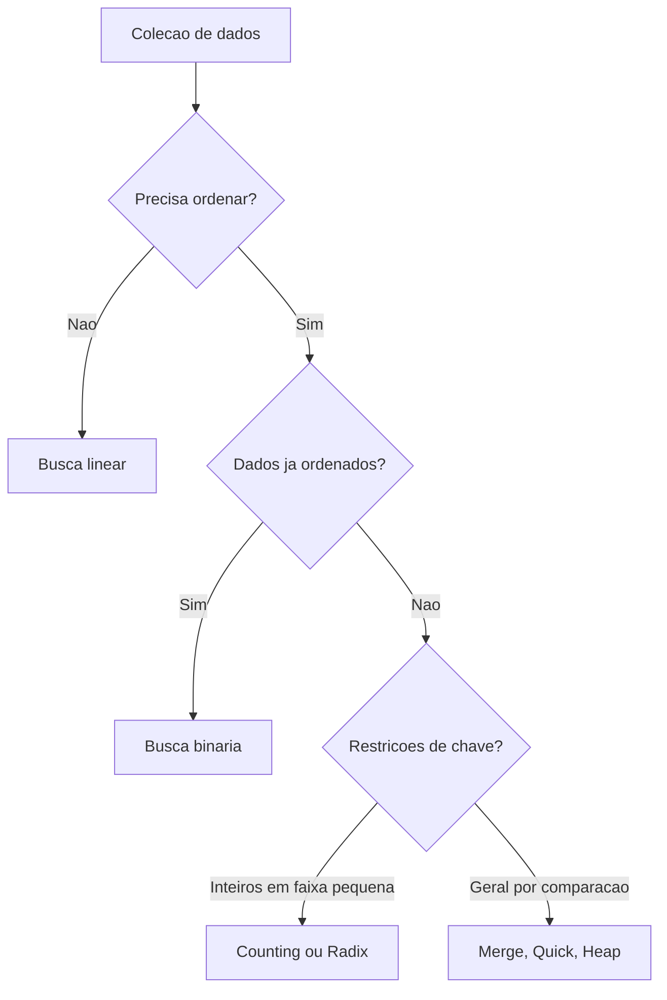

# Algoritmos de busca e ordenação

## 1. Introdução

Busca e ordenação compõem o núcleo clássico da análise de algoritmos. Quase todo sistema computacional, direta ou indiretamente, depende de localizar registros, manter coleções ordenadas, mesclar conjuntos ou reorganizar dados para acelerar consultas. A história da área é marcada precisamente por avanços nesse domínio, desde métodos quadráticos elementares até estratégias assintoticamente sofisticadas e sensíveis à arquitetura de memória (Knuth, 1998; Cormen et al., 2009).

## 2. Fundamentação Teórica

O problema de busca consiste em determinar a presença e, em geral, a posição de uma chave em uma coleção. O problema de ordenação consiste em permutar os elementos de uma sequência segundo uma relação de ordem. Esses problemas estão intimamente ligados: uma vez ordenados, os dados admitem buscas sublineares como busca binária. Em contrapartida, ordenar pode custar mais do que sucessivas buscas lineares quando o volume de consultas é pequeno.

Estabilidade, adaptatividade, uso de memória extra e comportamento em melhor, médio e pior caso são atributos decisivos. Algoritmos estáveis preservam a ordem relativa de chaves iguais. Algoritmos in-place usam memória adicional assintoticamente constante ou muito pequena. Métodos por comparação obedecem ao limite inferior $\Omega(n \log n)$ no pior caso médio, enquanto abordagens como Counting Sort e Radix Sort exploram propriedades das chaves para superar esse limite em contextos específicos (Cormen et al., 2012).

## 3. Desenvolvimento

A seguir, apresenta-se uma visão geral dos principais algoritmos de busca e ordenação, suas implementações, complexidades e casos de uso típicos.



### 3.1 Algoritmos de busca

| Algoritmo     | Facilidade de implementação | Facilidade de uso | Desempenho               | Consumo de memória                 | Vantagens          | Desvantagens       | Casos de uso                       | Big O                      |
| ------------- | --------------------------- | ----------------- | ------------------------ | ---------------------------------- | ------------------ | ------------------ | ---------------------------------- | -------------------------- |
| Busca linear  | Alta                        | Alta              | Fraco em grandes vetores | O(1)                               | Dispensa ordenação | Escala linearmente | Coleções pequenas ou não ordenadas | Melhor O(1), pior O(n)     |
| Busca binária | Alta                        | Alta              | Excelente                | O(1) iterativa, O(log n) recursiva | Muito eficiente    | Exige ordenação    | Índices e consultas repetidas      | Melhor O(1), pior O(log n) |

#### Algoritmo 1: busca linear

A busca linear é o tipo mais simples de busca: percorre o vetor do início ao fim, comparando cada elemento com a chave. É eficiente para vetores pequenos ou quando a ordenação não é viável.

**Pseudocódigo**

```text
algoritmo busca_linear(vetor, n, chave)
    para i de 0 ate n - 1 faca
        se vetor[i] = chave entao retorne i
    retorne -1
fim
```

**Implementação completa em C**

```c
int busca_linear(const int vetor[], int tamanho, int chave) {
    for (int indice = 0; indice < tamanho; indice++) {
        if (vetor[indice] == chave) {
            return indice;
        }
    }
    return -1;
}
```

**Complexidade.** Melhor caso $O(1)$, médio e pior caso $O(n)$, espaço $O(1)$.

**Explicação relevante.** O laço é interrompido no primeiro sucesso, o que torna o custo médio dependente da distribuição das consultas.

**Entrada e saída.** Vetor `{9, 4, 7, 2}`, chave `7`, saída `2`.

**Comparação.** Superior à busca binária apenas quando não se justifica ordenar ou manter estrutura ordenada.

#### Algoritmo 2: busca binária iterativa

A busca binária é um método eficiente para vetores ordenados. Ela divide o espaço de busca pela metade a cada iteração, comparando a chave com o elemento do meio.

**Pseudocódigo**

```text
algoritmo busca_binaria(vetor, n, chave)
    inicio <- 0
    fim <- n - 1
    enquanto inicio <= fim faca
        meio <- inicio + (fim - inicio) / 2
        se vetor[meio] = chave entao retorne meio
        se chave < vetor[meio] entao fim <- meio - 1
        senao inicio <- meio + 1
    retorne -1
fim
```

**Implementação completa em C**

```c
int busca_binaria(const int vetor[], int tamanho, int chave) {
    int inicio = 0;
    int fim = tamanho - 1;

    while (inicio <= fim) {
        int meio = inicio + (fim - inicio) / 2;
        if (vetor[meio] == chave) {
            return meio;
        }
        if (chave < vetor[meio]) {
            fim = meio - 1;
        } else {
            inicio = meio + 1;
        }
    }
    return -1;
}
```

**Complexidade.** Melhor caso $O(1)$, médio e pior $O(\log n)$, espaço $O(1)$.

**Partes importantes.** O cálculo de `meio` evita overflow potencial; a pré-condição de ordenação é indispensável.
