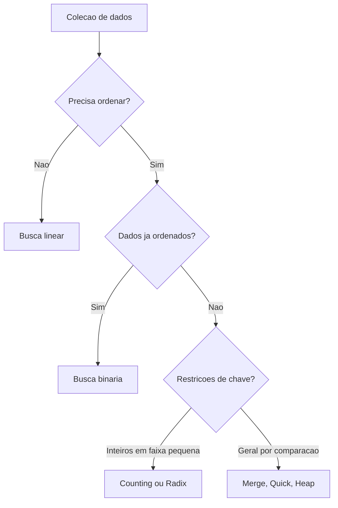

# Algoritmos de busca e ordenação

## 1. Introdução

Busca e ordenação compõem o núcleo clássico da análise de algoritmos. Quase todo sistema computacional, direta ou indiretamente, depende de localizar registros, manter coleções ordenadas, mesclar conjuntos ou reorganizar dados para acelerar consultas. A história da área é marcada precisamente por avanços nesse domínio, desde métodos quadráticos elementares até estratégias assintoticamente sofisticadas e sensíveis à arquitetura de memória (Knuth, 1998; Cormen et al., 2009).

## 2. Fundamentação Teórica

O problema de busca consiste em determinar a presença e, em geral, a posição de uma chave em uma coleção. O problema de ordenação consiste em permutar os elementos de uma sequência segundo uma relação de ordem. Esses problemas estão intimamente ligados: uma vez ordenados, os dados admitem buscas sublineares como busca binária. Em contrapartida, ordenar pode custar mais do que sucessivas buscas lineares quando o volume de consultas é pequeno.

Estabilidade, adaptatividade, uso de memória extra e comportamento em melhor, médio e pior caso são atributos decisivos. Algoritmos estáveis preservam a ordem relativa de chaves iguais. Algoritmos in-place usam memória adicional assintoticamente constante ou muito pequena. Métodos por comparação obedecem ao limite inferior $\Omega(n \log n)$ no pior caso médio, enquanto abordagens como Counting Sort e Radix Sort exploram propriedades das chaves para superar esse limite em contextos específicos (Cormen et al., 2012).

## 3. Desenvolvimento

A seguir, apresenta-se uma visão geral dos principais algoritmos de busca e ordenação, suas implementações, complexidades e casos de uso típicos.



### 3.1 Algoritmos de busca

| Algoritmo     | Facilidade de implementação | Facilidade de uso | Desempenho               | Consumo de memória                 | Vantagens          | Desvantagens       | Casos de uso                       | Big O                      |
| ------------- | --------------------------- | ----------------- | ------------------------ | ---------------------------------- | ------------------ | ------------------ | ---------------------------------- | -------------------------- |
| Busca linear  | Alta                        | Alta              | Fraco em grandes vetores | O(1)                               | Dispensa ordenação | Escala linearmente | Coleções pequenas ou não ordenadas | Melhor O(1), pior O(n)     |
| Busca binária | Alta                        | Alta              | Excelente                | O(1) iterativa, O(log n) recursiva | Muito eficiente    | Exige ordenação    | Índices e consultas repetidas      | Melhor O(1), pior O(log n) |

#### Algoritmo 1: busca linear

A busca linear é o tipo mais simples de busca: percorre o vetor do início ao fim, comparando cada elemento com a chave. É eficiente para vetores pequenos ou quando a ordenação não é viável.

**Pseudocódigo**

```text
algoritmo busca_linear(vetor, n, chave)
    para i de 0 ate n - 1 faca
        se vetor[i] = chave entao retorne i
    retorne -1
fim
```

**Implementação completa em C**

```c
int busca_linear(const int vetor[], int tamanho, int chave) {
    for (int indice = 0; indice < tamanho; indice++) {
        if (vetor[indice] == chave) {
            return indice;
        }
    }
    return -1;
}
```

**Complexidade.** Melhor caso $O(1)$, médio e pior caso $O(n)$, espaço $O(1)$.

**Explicação relevante.** O laço é interrompido no primeiro sucesso, o que torna o custo médio dependente da distribuição das consultas.

**Entrada e saída.** Vetor `{9, 4, 7, 2}`, chave `7`, saída `2`.

**Comparação.** Superior à busca binária apenas quando não se justifica ordenar ou manter estrutura ordenada.

#### Algoritmo 2: busca binária iterativa

A busca binária é um método eficiente para vetores ordenados. Ela divide o espaço de busca pela metade a cada iteração, comparando a chave com o elemento do meio.

**Pseudocódigo**

```text
algoritmo busca_binaria(vetor, n, chave)
    inicio <- 0
    fim <- n - 1
    enquanto inicio <= fim faca
        meio <- inicio + (fim - inicio) / 2
        se vetor[meio] = chave entao retorne meio
        se chave < vetor[meio] entao fim <- meio - 1
        senao inicio <- meio + 1
    retorne -1
fim
```

**Implementação completa em C**

```c
int busca_binaria(const int vetor[], int tamanho, int chave) {
    int inicio = 0;
    int fim = tamanho - 1;

    while (inicio <= fim) {
        int meio = inicio + (fim - inicio) / 2;
        if (vetor[meio] == chave) {
            return meio;
        }
        if (chave < vetor[meio]) {
            fim = meio - 1;
        } else {
            inicio = meio + 1;
        }
    }
    return -1;
}
```

**Complexidade.** Melhor caso $O(1)$, médio e pior $O(\log n)$, espaço $O(1)$.

**Partes importantes.** O cálculo de `meio` evita overflow potencial; a pré-condição de ordenação é indispensável.

### 3.2 Algoritmos simples de ordenação

#### Algoritmo 3: Bubble Sort

**Explicação teórica.** Repetidas trocas adjacentes movem gradualmente maiores elementos para o final. É estável e simples, porém ineficiente.

**Pseudocódigo**

```text
algoritmo bubble_sort(vetor, n)
    para i de 0 ate n - 2 faca
        houve_troca <- falso
        para j de 0 ate n - 2 - i faca
            se vetor[j] > vetor[j + 1] entao
                troque vetor[j] e vetor[j + 1]
                houve_troca <- verdadeiro
        se nao houve_troca entao pare
```

**Implementação completa em C**

```c
void bubble_sort(int vetor[], int tamanho) {
    for (int i = 0; i < tamanho - 1; i++) {
        int houve_troca = 0;
        for (int j = 0; j < tamanho - 1 - i; j++) {
            if (vetor[j] > vetor[j + 1]) {
                int temp = vetor[j];
                vetor[j] = vetor[j + 1];
                vetor[j + 1] = temp;
                houve_troca = 1;
            }
        }
        if (!houve_troca) {
            break;
        }
    }
}
```

**Complexidade.** Melhor caso $O(n)$ com otimização, médio e pior $O(n^2)$, espaço $O(1)$.

#### Algoritmo 4: Selection Sort

O selection sort seleciona o menor elemento do vetor e o coloca na posição correta. Ele minimiza o número de trocas, mas não é adaptativo.

**Pseudocódigo**

```text
algoritmo selection_sort(vetor, n)
    para i de 0 ate n - 2 faca
        minimo <- i
        para j de i + 1 ate n - 1 faca
            se vetor[j] < vetor[minimo] entao
                minimo <- j
        troque vetor[i] e vetor[minimo]
```

**Implementação completa em C**

```c
void selection_sort(int vetor[], int tamanho) {
    for (int i = 0; i < tamanho - 1; i++) {
        int minimo = i;
        for (int j = i + 1; j < tamanho; j++) {
            if (vetor[j] < vetor[minimo]) {
                minimo = j;
            }
        }
        int temp = vetor[i];
        vetor[i] = vetor[minimo];
        vetor[minimo] = temp;
    }
}
```

**Complexidade.** Melhor, médio e pior caso $O(n^2)$; espaço $O(1)$; não é estável na forma clássica.

#### Algoritmo 5: Insertion Sort

**Explicação teórica.** Mantém um prefixo ordenado e insere cada novo elemento em sua posição correta. É estável e adaptativo.

**Pseudocódigo**

```text
algoritmo insertion_sort(vetor, n)
    para i de 1 ate n - 1 faca
        chave <- vetor[i]
        j <- i - 1
        enquanto j >= 0 e vetor[j] > chave faca
            vetor[j + 1] <- vetor[j]
            j <- j - 1
        vetor[j + 1] <- chave
```

**Implementação completa em C**

```c
void insertion_sort(int vetor[], int tamanho) {
    for (int i = 1; i < tamanho; i++) {
        int chave = vetor[i];
        int j = i - 1;
        while (j >= 0 && vetor[j] > chave) {
            vetor[j + 1] = vetor[j];
            j--;
        }
        vetor[j + 1] = chave;
    }
}
```

**Complexidade.** Melhor caso $O(n)$, médio e pior $O(n^2)$; espaço $O(1)$.

**Comparação dos métodos simples.** Bubble realiza muitas trocas; Selection minimiza trocas, mas não comparações; Insertion é o melhor em vetores pequenos ou quase ordenados.

### 3.3 Algoritmos eficientes por comparação

#### Algoritmo 6: Merge Sort

O merge sort é um algoritmo de divisão e conquista que divide o vetor em metades, ordena recursivamente e intercala os resultados. É estável e tem desempenho garantido $O(n \log n)$.

**Pseudocódigo**

```text
algoritmo merge_sort(v, l, r)
    se l >= r entao retorne
    m <- (l + r) / 2
    merge_sort(v, l, m)
    merge_sort(v, m + 1, r)
    intercale(v, l, m, r)
fim

algoritmo intercale(v, l, m, r)
    n1 <- m - l + 1
    n2 <- r - m
    L[0..n1 - 1] <- v[l..m]
    R[0..n2 - 1] <- v[m + 1..r]
    i <- j <- 0
    k <- l
    enquanto i < n1 e j < n2 faca
        se L[i] <= R[j] entao
            v[k++] <- L[i++]
        senao
            v[k++] <- R[j++]
    enquanto i < n1 faca
        v[k++] <- L[i++]
    enquanto j < n2 faca
        v[k++] <- R[j++]
```

**Implementação completa em C**

```c
void merge(int vetor[], int esquerda, int meio, int direita) {
    int n1 = meio - esquerda + 1;
    int n2 = direita - meio;
    int esquerda_temp[128];
    int direita_temp[128];

    for (int i = 0; i < n1; i++) esquerda_temp[i] = vetor[esquerda + i];
    for (int j = 0; j < n2; j++) direita_temp[j] = vetor[meio + 1 + j];

    int i = 0, j = 0, k = esquerda;
    while (i < n1 && j < n2) {
        if (esquerda_temp[i] <= direita_temp[j]) {
            vetor[k++] = esquerda_temp[i++];
        } else {
            vetor[k++] = direita_temp[j++];
        }
    }
    while (i < n1) vetor[k++] = esquerda_temp[i++];
    while (j < n2) vetor[k++] = direita_temp[j++];
}

void merge_sort(int vetor[], int esquerda, int direita) {
    if (esquerda >= direita) {
        return;
    }
    int meio = esquerda + (direita - esquerda) / 2;
    merge_sort(vetor, esquerda, meio);
    merge_sort(vetor, meio + 1, direita);
    merge(vetor, esquerda, meio, direita);
}
```

**Complexidade.** Melhor, médio e pior $O(n \log n)$; espaço extra $O(n)$; estável; profundidade recursiva $O(\log n)$.

#### Algoritmo 7: Quick Sort

**Explicação teórica.** Quick Sort particiona o vetor em torno de um pivô. É tipicamente muito rápido na prática, embora tenha pior caso quadrático sem cuidados de pivoteamento.

**Pseudocódigo**

```text
algoritmo quick_sort(vetor, baixo, alto)
    se baixo < alto entao
        p <- particionar(vetor, baixo, alto)
        quick_sort(vetor, baixo, p - 1)
        quick_sort(vetor, p + 1, alto)
fim

algoritmo particionar(vetor, baixo, alto)
    pivo <- vetor[alto]
    i <- baixo - 1
    para j de baixo ate alto - 1 faca
        se vetor[j] <= pivo entao
            i <- i + 1
            troque vetor[i] e vetor[j]
    troque vetor[i + 1] e vetor[alto]
    retorne i + 1
fim
```

**Implementação completa em C**

```c
int particionar(int vetor[], int baixo, int alto) {
    int pivo = vetor[alto];
    int i = baixo - 1;
    for (int j = baixo; j < alto; j++) {
        if (vetor[j] <= pivo) {
            i++;
            int temp = vetor[i];
            vetor[i] = vetor[j];
            vetor[j] = temp;
        }
    }
    int temp = vetor[i + 1];
    vetor[i + 1] = vetor[alto];
    vetor[alto] = temp;
    return i + 1;
}

void quick_sort(int vetor[], int baixo, int alto) {
    if (baixo < alto) {
        int p = particionar(vetor, baixo, alto);
        quick_sort(vetor, baixo, p - 1);
        quick_sort(vetor, p + 1, alto);
    }
}
```

**Complexidade.** Melhor e médio $O(n \log n)$; pior $O(n^2)$; espaço de pilha médio $O(\log n)$ e pior $O(n)$; não é estável; in-place.
O pior caso ocorre quando o pivô é consistentemente o menor ou maior elemento, como em vetores já ordenados ou inversamente ordenados. Estratégias de pivoteamento, como escolha aleatória ou mediana de três, podem mitigar esse risco.

#### Algoritmo 8: Heap Sort

**Explicação teórica.** Heap Sort constrói um heap máximo e extrai o maior elemento repetidamente. Tem garantia de pior caso $O(n \log n)$, mas não é estável.

**Pseudocódigo**

```text
algoritmo heapify(vetor, tamanho, raiz)
    maior <- raiz
    esquerda <- 2 * raiz + 1
    direita <- 2 * raiz + 2

    se esquerda < tamanho e vetor[esquerda] > vetor[maior] entao
        maior <- esquerda
    se direita < tamanho e vetor[direita] > vetor[maior] entao
        maior <- direita

    se maior != raiz entao
        troque vetor[raiz] e vetor[maior]
        heapify(vetor, tamanho, maior)
fim

algoritmo heap_sort(vetor, tamanho)
    para i de tamanho / 2 - 1 ate 0 faca
        heapify(vetor, tamanho, i)
    para i de tamanho - 1 ate 1 faca
        troque vetor[0] e vetor[i]
        heapify(vetor, i, 0)
fim
```

**Implementação completa em C**

```c
void heapify(int vetor[], int tamanho, int raiz) {
    int maior = raiz;
    int esquerda = 2 * raiz + 1;
    int direita = 2 * raiz + 2;

    if (esquerda < tamanho && vetor[esquerda] > vetor[maior]) maior = esquerda;
    if (direita < tamanho && vetor[direita] > vetor[maior]) maior = direita;

    if (maior != raiz) {
        int temp = vetor[raiz];
        vetor[raiz] = vetor[maior];
        vetor[maior] = temp;
        heapify(vetor, tamanho, maior);
    }
}

void heap_sort(int vetor[], int tamanho) {
    for (int i = tamanho / 2 - 1; i >= 0; i--) heapify(vetor, tamanho, i);
    for (int i = tamanho - 1; i > 0; i--) {
        int temp = vetor[0];
        vetor[0] = vetor[i];
        vetor[i] = temp;
        heapify(vetor, i, 0);
    }
}
```

**Complexidade.** Melhor, médio e pior $O(n \log n)$; espaço adicional $O(1)$; não estável; in-place.
